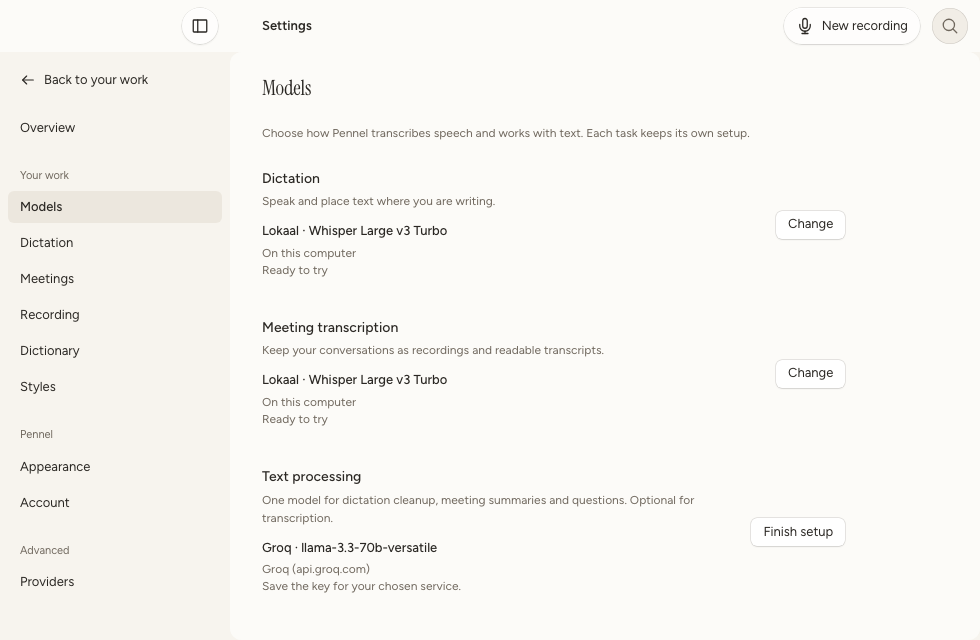
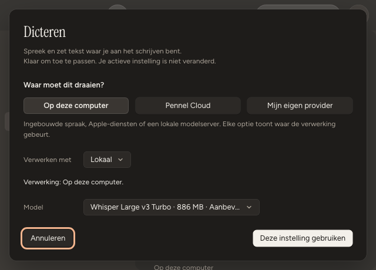

# Shared Pennel desktop app

Device connection availability, recovery boundaries and current verification: [device connection](device-connection.md).

`apps/desktop/` hosts one Tauri 2 application for Mac, Windows and Linux. Its TypeScript/Vite interface links through Rust commands to one `PennelEngine`. The legacy SwiftUI Mac shell is retired under [cleanup #75](https://github.com/pennel-app/pennel/issues/75). The embedded macOS platform library remains the owner of Apple integrations; packaged-device and signed-upgrade acceptance remain separate.

The [macOS-first phase (#174)](https://github.com/pennel-app/pennel/issues/174), approved on 8 November 2026, pauses routine Windows/Linux product validation and new installers. Shared platform code and the capability guidance below remain; see [current CI and release scope](#verification-and-release-state).

The main window **Pennel** has two primary task spaces: **Dictation** and **Meetings**, with **Settings** below. **History** and **Write in Pennel** are nested directly under Dictation, before Meetings. Dictation leads with the shortcut for writing in another app, five recent results and **All history**; the persistent pad is secondary. Meetings owns its library, contextual questions and recording workflow. One sidebar search follows the selected task. `Cmd/Ctrl+F` restores and focuses it when the sidebar is collapsed, preserving the query. Legacy History, Settings and model links still resolve inside this window.

The compact toolbar keeps **New recording** and sidebar visibility available. The context label aligns with the reading column, and the recording action stays vertically centered on the same right edge as the content actions below. An active or unfinished recording replaces New recording with a return to that exact session across both tasks and Settings. Settings opens from the tray/menu, in-app links or `Cmd/Ctrl+,`; Back returns to the originating work. Task switches, Settings and reopening preserve drafts, selected meetings, source targets and reading position, and reopening restores the last task. The recording prompt and nonactivating dictation pill remain separate. Platform-specific features stay visible with capability/permission explanations.

Settings has six categories: **Dictation**, **Dictionary**, **Meetings**, **Appearance**, **Sync & account** and **Advanced**, and remembers the selected category when reopened. Readiness, **Change** and **Finish setup** sit with the relevant task. Text processing still shares one model for dictation cleanup, meeting summaries and questions. Dictionary has its own category, so adding terms never collapses it; styles sit under Dictation; recording options sit under Meetings; Connections and Models/experimental details remain discoverable under Advanced. There is no duplicate Overview/Models readiness page. Vertical category navigation replaces the task sidebar while Settings is open; active recording state and its return action remain visible. Existing detailed links route to their owning category. **Ready to try / Klaar om te proberen** reports configuration and queryable access, not proof that a real provider or microphone test has succeeded.

Task readiness, task settings and recovery open the same guided setup dialog over the initiating view. One compatible local speech recommendation leads, with **Other options** retaining Cloud, provider and detailed model choices. Model choices remain drafts until **Use this setup** succeeds; **Cancel** or Escape returns without changing the active task assignment. Connection details, keys, downloads and sign-in have separate explicit actions and can remain after cancellation, as explained in the chooser. A failed save keeps the dialog and error available. Meetings keep personal notes, selected views, source navigation and reading position through processing and setup. Missing summary configuration has a visible **Set up summaries** action even if an earlier summary already exists; questions provide their own setup route.

## Meeting workspace

Recording, processing, review and reopening use the same notes-first meeting document. **Your notes** remains distinct from **Summary**; title, recording state, elapsed time and **Stop** stay available without opening a tool panel. Transcript and Questions are optional companions, initially closed, with an equivalent single-pane presentation in narrow windows. **More** retains people and speakers, templates, suggestions and file actions. Capture, typed notes and question drafts remain available without a text model or Cloud; generated summaries and answers explain any required setup.

Notes use one retained inline Markdown editor during recording and after completion. Headings, bold, bullets and tasks resolve in place; the caret line reveals its source markers. Stored Markdown and source-selection offsets stay unchanged. The footer shows **Saved** and heading, bold, list and task controls. Formatting, task toggles and explicit people/suggestion inserts participate in undo/redo and the existing autosave path; background hydration stays quiet. Code fences, inline code and escaped markers remain literal. The distribution includes the pinned CodeMirror packages' MIT notices in `third-party-codemirror.txt`.

Summary opens as formatted text. **Edit** enters exact Markdown editing and **Done** returns to reading, with Saving/Saved/Not saved status, retry and recoverable revision history. Save, restore and generated-candidate acceptance check the summary and source revisions before writing. A newer edit or changed source is preserved for review instead of being overwritten by a late result. Personal summary generation can use typed notes and finalized transcript, with the actual processing destination shown before the request. Note drafts, focus and selection survive summary work.

Automatic summaries use the shared **Unanswered / Manual / Automatic** setting. New and upgraded profiles persist Unanswered until the owner chooses; manual generation remains available. Only an explicit saved Automatic choice authorizes automatic generation. Work is bound to the stable meeting and source snapshot, and failures do not trigger an implicit retry or another provider.

Meeting and conversation names are automatic and remain editable. An unnamed new meeting starts with a dated name; useful calendar names are kept. After existing postprocessing, one background request can refine the name through the selected text model using at most 4,000 UTF-8 bytes from the finalized transcript, with no personal notes. This naming request is independent of automatic-summary consent, as explained in Meetings settings. Conversations get a dated name, a first-question fallback and one topic-title attempt after their first completed answer. Missing or failed models retain the local name. Title jobs have a fifteen-second deadline, yield to foreground work and never retry on reopening. Manual edits, nonempty legacy titles and changed sources/configuration reject late results; automatic meeting naming updates frontmatter without moving the folder. See [implementation and verification](evidence/automatic-meeting-titles-248.md).

Copy/export starts with a preview of the exact selected output. The default **Shareable** scope requires a current transcript-only summary with known provenance; typed notes, personal summaries and material derived from private notes are excluded. Missing or unknown legacy provenance produces a useful explanation rather than a personal-content fallback. **Personal** copy/export is a separate intentional owner choice. See the [domain glossary](../GLOSSARY.md) for these terms and the [#141 implementation receipt](evidence/simpler-pennel-141.md) for verification and outstanding acceptance.

## Appearance and first use

**System / Systeem**, **Light / Licht** and **Dark / Donker** use the desktop-specific `desktop-theme` overrides in `assets/brand/tokens.json`: neutral light/dark content and sidebar surfaces, locally bundled Inter, compact titles, inset rounded panes and consistent capsule controls. Navigation selection stays neutral; primary actions and focus use blue, with separate error/destructive colors. `make theme` generates base and desktop CSS, pill metrics and shared SVG icons; `make theme-check` checks that the committed outputs match. The desktop overrides are loaded only by the main frontend, including onboarding and prompts. Mobile keeps the base warm palette and Figtree/Instrument Serif typography, the wordmark artwork remains unchanged, and the separate floating pill retains its fixed colors. See the [desktop design contract](../DESIGN.md) and [brand guide](../assets/brand/brand.md).

Webview zoom shortcuts are disabled. Enlarged-text fixtures exercise responsive layout, but do not establish OS text-size or human accessibility acceptance. On macOS, native Liquid Glass backs navigation and toolbar surfaces on version 26 and newer; older versions use system vibrancy. Reduce Transparency and Increase Contrast select opaque backing, and Reduce Motion suppresses transitions. Reading and editing content stays opaque. See the [macOS material audit, visual references and verification](macos-liquid-glass.md).

Standard choice popups, action menus and meeting-row context menus use Tauri's native system menus. Their triggers retain Pennel styling; menu fonts, animation and accessibility follow the operating system. Labels, available actions and disabled states remain shared. Keyboard activation, arrow navigation and Escape are supported; owned browser fixtures use an equivalent renderer menu without invoking the native bridge. Native menu resources stay owned until selection, replacement or view disposal.

Meeting navigation highlights its destination before waiting for draft persistence. Independent detail/status reads run together; speaker setup, templates and summary annotations fill in after the document appears. Later navigation invalidates older responses, while save-before-leave, hide and quit barriers remain in place. The library retains keyed rows, keyboard focus and reading position; arrows, Home/End and type-to-select navigate its source list.

The visible library refreshes on local mutations, sync changes and focus, with a thirty-second recovery refresh. Settings pauses library queries and retains invalidations for the return to work. Lightweight runtime snapshots update the recording shortcut and clock without reading notes or copying transcripts. A transcript revision requests full content only after it changes; unchanged live rows retain their DOM/text nodes. Filesystem-bearing commands run off the native UI thread and retain durable writes. Repeatable synthetic Mac WebKit measurements and their limits are recorded in [desktop performance](desktop-performance.md).

First use offers **Try dictation** or **Record a meeting**, with an interface-language choice on Welcome. New profiles recommend compatible local speech recognition in **Fast / Snel** mode; **Other options** reveals speech language, engine/model and provider alternatives. Setup carries the chosen task through its relevant access requirements. Dictation practice requires a real nonempty result and then offers **Open dictation**. The meeting path shows **Ready for your first meeting** and **Continue to recording**: it explicitly is not recording yet, and opens the real recording workflow for checking sources and starting capture. That navigation is not evidence of an actual recorded meeting.

Optional voice enrollment remains under Settings → Meetings rather than extending ordinary first use. Older saved Language and Voice steps stay resumable. Model downloads and provider credentials use the existing core and OS credential services. A saved wizard step is not proof that a model or permission remains available. Existing profiles keep their providers, models, dictation mode and unfinished setup. Windows and Linux open the workspace at launch; Mac uses the menu bar lifecycle below.

Microphone access is required for recording. Global shortcuts, external placement, meeting audio and optional speech/calendar features have their own permission requirements; unsupported controls remain visible with an explanation in **Instellingen**. On an Apple keyboard, set **System Settings → Keyboard → Press 🌐 key to → Do Nothing** when using `fn`. Logitech MX keyboards can use **Rechter Option** under **Instellingen → Dicteren → Sneltoets** instead.

The dictation home reports **Ready to dictate**, or **Ready to try in Pennel** when external shortcut/placement access is unavailable. **Try it here** opens owned practice without changing saved onboarding goal/progress; **Dictation settings** is secondary. Practice uses a temporary Fast setting and never uses external paste or clipboard delivery.

The separately available dictation pad retains an editable local draft. **Dicteerpad ook extern plakken** is off by default and applies only to recordings made in that pad. Enabling it captures the previous external target when recording starts; it does not change normal shortcut dictation in other apps. If the captured target cannot be used, the text remains in the pad.

Window closing and navigation invalidate pending owned external delivery. Meeting recording and the normal background runtime retain their existing lifetime. Real device and platform acceptance are recorded separately in [redesign acceptance](redesign-acceptance.md).

### Interface language

The shared desktop app supports **English** and **Nederlands** on macOS, Windows and Linux. First use offers **System language**, **English** and **Nederlands**; the same choice is available in **Settings → Appearance**. System language is the default and shows the language it currently resolves to. Pennel chooses the first supported language in the system preference list, including regional variants, and falls back to English. System preferences are read on launch; an operating-system language change applies when Pennel next starts.

Changing the interface preference saves and relabels open desktop windows, menus and recording overlays immediately. It does not reload a webview, replace active text fields, stop a recording, or change speech recognition, provider/model choices, prompts, template contents, transcripts or notes. Existing profiles keep their onboarding progress, and language remains available when reopening the introduction.

Translations live in the shared `assets/locales/` catalogs. Frontend `l()`/`liveText()` values explicitly mark app-owned text and attributes for in-place updates; raw user content is never matched or scanned for translation. Rust resolves preferences and supplies localized native UI metadata. Application-owned diagnostics and canonical defaults use English; the catalogs retain older Dutch error aliases. Unmodified built-in names follow the interface, while default summary headings follow the meeting language and custom template content stays literal. See the [language policy](language-policy.md). No remote translation service or extra dependency is used. Historical native Mac UI source remains available in Git.

## Mac menu bar lifecycle

The shared Tauri app stays in the Mac menu bar while its product windows are hidden. Opening the workspace or onboarding exposes normal application menus and a Dock/Cmd-Tab entry; closing the last product window returns it to accessory mode. The recording prompt and pill remain nonactivating. First launch or unfinished setup opens onboarding. Its completion action opens the selected dictation or meeting workflow; later cold launches stay in the menu bar.

Click the Pennel icon for the native action menu. **Start opname**, **Stop opname** and **Opname afronden…** reflect the recording runtime; the icon distinguishes an active recording and the dictation hint reports actual shortcut availability. **Open Pennel** opens the main workspace, or resumes unfinished onboarding. Opening the running app through Finder or Spotlight does the same. Dictation, Meetings, History and Settings all use that same main window, including menu/tray actions and legacy links.

Closing a product window saves its drafts before hiding it, without changing the other windows. If saving fails or times out, Pennel keeps that window open with an error. Reopening restores its owned session and refreshes the view; presentation polling pauses while hidden. Global dictation, the pill and meeting recording continue independently of window visibility. **Stop Pennel** uses the existing shutdown path to save drafts and finalize recordings.

## Dictation destinations and live text

### Saving and recovery

The shared app keeps completed dictation text available even when History cannot write to SQLite. **Nog niet bewaard** entries appear first in History, with **Kopiëren**, **Opnieuw bewaren** and explicit discard. Saving again never repeats recognition or pastes into another application. A failed save cancels automatic placement in the original destination; recovery notices refer to the exact dictation rather than whichever result finished last. Clipboard-write failures also stop placement instead of sending a paste command with stale clipboard contents.

Temporary recovery entries live only in the running process. Pennel tries to save them before quitting or updating and stays open when saving still fails. Explicitly discarding an entry works even when SQLite is unavailable. New dictation is blocked at twenty retained/in-flight results or the five-MiB recovery budget; an unexpectedly oversized completed result is kept intact and blocks further capture until resolved. Closing a window does not discard temporary results. A process or computer crash cannot preserve memory-only text.

Meeting audio chunks are durably written before recognition. Recognition queues file references rather than unbounded PCM; the capture ingress is bounded. Transcript replacement is atomic and recovery audio is removed only after its matching transcript is committed. Repeated storage failures stop capture with a persistent warning and retain the remaining material for **Opnieuw bewaren**, which does not rerun successful recognition. Pending WAVs are discovered after a restart. New recovery filenames and optional millisecond transcript timestamps prevent short chunks in the same second from overwriting one another; existing whole-second files remain readable, and ordinary timestamp display/export is unchanged.

Two consecutive failed recognition chunks pause further recognition requests for that recording while audio continues to be saved. The recording screen explains the pause; failed chunks can be transcribed explicitly after recording. Fatal capture/storage errors stop recording, retain notes and title drafts, and prevent a new recording from replacing unsaved material.

Speech provider, model, language, dictionary and credentials are frozen when a meeting starts. The live screen reports the frozen, nonsecret recognition configuration. Later settings edits apply to the next recording; summaries and questions use the model chosen when requested. Cloud account changes are blocked during an active meeting, while normal token refresh for the same account remains available.

Finished meetings expose **Opnieuw transcriberen vanaf opname** / **Transcribe again from recording**, separately from retrying failed chunks. Confirmation shows the selected local meeting model and language. Audio is decoded one track at a time, retaining its original silence and timeline; known local dictation exclusions are masked on both tracks. Recognition settings and dictionary are frozen for the job. This action never uses cloud speech recognition or requests a new summary, and it does not switch the selected model.

The old transcript remains available while recognition runs. A successful replacement keeps a private, versioned copy of the previous transcript, speaker names, summary metadata and any failed-chunk audio under `.pennel-transcript-backups`. A durable transaction journal restores that version after an interrupted save, before the next library open, index or sync. Notes and recordings stay in place. The retained summary is marked outdated. Existing speaker labels are rebuilt with downloaded local speaker models when available; names transfer only through voice matching, otherwise the physical microphone/computer roles remain. Conflicting edits to the same meeting are blocked while progress is shown.

Speaker recognition now records physical transcript sources before relabelling a shared microphone. Older diarized transcripts without source metadata require both saved tracks: a voice labelled “Anderen” alone cannot establish whether it came from the microphone or computer. Missing required recordings, models, or unreadable exclusion metadata prevent replacement. Legacy recordings without saved dictation intervals cannot reconstruct past exclusions.

The timestamp regression and replacement/error recovery paths are covered by automated tests. Real Parakeet versus Whisper Large v3 Turbo quality comparison and recording/retranscription on an actual Mac remain acceptance work; model weights were unavailable in the implementation environment. The existing Linux Mac-AAC compatibility decode failure is tracked separately from the core timestamp fix.

**Dicteren** opens the global workflow. Click a text field in another app, hold the configured shortcut and release to paste there. The main Pennel window does not need to be open. **Open dicteerpad** is an explicit secondary action; its existing local-draft and optional external-paste behavior remain separate from global dictation.

Global dictation freezes an opaque external target when recording stops, before asynchronous transcription and cleanup. Provider, language, mode and dictionary are frozen at recording start; app-specific style context comes from the same stop target as delivery. A changed or unavailable target is never replaced with another recipient. The completed result remains in History with a recovery message. Mac additionally checks the captured Accessibility text-field identity; Windows/X11 currently guard the app, window and process-launch identity rather than exact field identity. Wayland retains its explicit copy-only behavior.

`LiveDictationSession` owns preview IDs, monotonic revisions and cancellation in the shared core. Apple uses the existing selected system provider through `SpeechAnalyzer` with volatile results. Local models use one cancellable decode at a time over a bounded six-second audio tail. Cloud providers remain one final ASR request; their raw result can appear before cleanup, without extra preview requests. Preview cannot write history, run cleanup/commands, read selections or paste. The authoritative final pass uses the same frozen settings. Closing or cancelling an owned pad/practice session also cancels pending finalization, preventing later result/history commits.

The non-activating pill shows up to two recent lines and keeps the last caption while processing. Session, revision and owner guards reject stale text and audio-level updates. Its dimensions and colors come from shared tokens. Apple preview stop closes and drains callbacks, then waits for analyzer cleanup off the UI thread before definitive recognition.

Delivery confirmations use the recording's preview identity, including after submission or cancellation. A newer recording clears an earlier Inserted/Copied confirmation and suppresses later confirmations from older recordings; older Problems and their History recovery links remain available. The pill stays Working until an enqueued external delivery ends, including an owned pad delivery, whose successful completion has no extra success notice. macOS can name the receiving app in Inserted. Windows/X11 currently provide executable identifiers rather than localized display names, so they show the same generic Inserted confirmation; display-name lookup remains a parity gap. Wayland keeps its explicit Copied confirmation.

Logitech MX keyboards do not transmit Apple's Fn/Globe keycode. They can use **Rechter Option** in **Instellingen → Dicteren → Sneltoets**; `fn` remains available for Apple keyboards. [Logitech's documentation](https://support.logi.com/hc/en-us/articles/29752695205527-Logitech-keyboard-FN-key-behavior-on-macOS-or-iOS).

The delivery and caption behavior was compared with [FluidVoice's stop-target policy](https://github.com/altic-dev/FluidVoice/blob/0fccdeb014462e6f82889af38c7e9de92d87a130/Sources/Fluid/Services/DictationTargetPolicy.swift) and [live recognition loop](https://github.com/altic-dev/FluidVoice/blob/0fccdeb014462e6f82889af38c7e9de92d87a130/Sources/Fluid/Services/ASRService.swift#L6982-L7278). Provider limitations differ; Pennel does not claim that a batch cloud endpoint streams during recording.

## Architecture and lifetime

| Layer | Responsibility |
| --- | --- |
| `core/` | Providers, processing, gestures/paste ordering, call debounce/rules, recording lifecycle, timestamped ingestion, stores, models, search/chat/templates/diarization/export |
| Tauri Rust host | One engine, application/background lifetime, command/event contracts, recording and dictation workers, native adapters, window/tray management and updates |
| Shared TypeScript views | Render snapshots and send explicit actions; no microphone capture or credential persistence |
| `apps/macos-platform/` | Swift/Core Audio/AVFoundation/Accessibility/EventKit/Apple Speech/Foundation Models behind an owned C ABI |
| Windows adapters | Win32 keyboard/clipboard/window services, WASAPI/audio sessions, Media Foundation AAC and endpoint-dependent echo processing |
| Linux adapters | X11 hooks/context, PulseAudio/PipeWire metadata and monitor capture, fixed GStreamer AAC pipelines, Wayland clipboard delivery |

The pill has core-backed Colour (Ink, Light, Match Pennel), Size (Compact, Regular, Large) and Position (Bottom centre, Top centre, Near the cursor) preferences. Ink and Regular remain the upgrade defaults. Match Pennel retains the stored `system` value and follows Pennel's effective appearance: the global System choice follows the OS, while an explicit Light/Dark override also applies to this following choice. Tauri's theme setter is app-wide on macOS and Linux; the pill never resets it independently. Token-generated dimensions feed both native placement and the webview; macOS uses logical AppKit points, and the portable path clamps scaled physical frames to display work areas. Wayland exposes the position choice disabled because the compositor owns floating-window placement. A separate click-through, nonactivating preview window displays these preferences for 2.4 seconds without requesting a capture snapshot or changing text, History or clipboard state. Real microphone, external-target and multi-display/native focus acceptance remains separate from geometry unit checks and mock renders.

The runtime survives main-window closing/reopening. Dictation, the meeting library and live-recording routes, History and Settings share one main window; onboarding, the recording prompt and pill retain their own presentation. Navigation preserves saved pad text, meeting notes and section context, and exact History recovery links select the intended entry inside main. Audio passes directly from native capture into Rust as 16 kHz mono Float32, with one recording timeline and interruption gaps. JavaScript receives state, levels, progress and targeted owned-session results. The Swift library has no SwiftUI or embedded Rust core; [its bridge documentation](../apps/macos-platform/README.md) describes ownership and main-queue requirements.

The main sidebar switches between Dictation and Meetings, with History and the pad grouped under Dictation, without opening another product window. Dictation remembers the home or pad surface, and Settings returns to the originating section. Pad edits are saved before a section switch. While an owned pad dictation is listening or processing, finish or explicitly cancel it before leaving; an attempted switch explains the requirement and leaves the session intact. This does not change global shortcut dictation or its nonactivating pill.

Recording uses `idle → starting → recording → stopping → finalizing → idle/error`. The runtime rejects concurrent starts and meeting-folder changes while active, and session identifiers protect newer meetings from older completions. Automatic call detection samples activity every two seconds, requires a sustained five-second candidate, and ends after thirty seconds without microphone activity. It stops only recordings associated with that detected call. The recording prompt expires after sixty seconds.

## Platform behavior

| Capability | macOS | Windows | Linux X11 | Linux Wayland |
| --- | --- | --- | --- | --- |
| Dictation trigger | Fn/right modifiers, native event tap | Right Ctrl/Alt or Ctrl+Super hook | Same gestures through XRecord | Configured compositor shortcut invokes manual toggle |
| Record shortcut | ⌘⇧R native tap | Ctrl+Shift+R registration | Ctrl+Shift+R registration | Configured shortcut invokes meeting toggle |
| Selection/insertion | Accessibility, guarded copy fallback, ⌘V | Guarded copy, foreground PID checks, SendInput | Guarded copy/paste, X11 foreground context | Copy result and paste manually; selection reading unavailable |
| Call observations | Core Audio process activity + browser titles | Audio sessions/process trees + browser titles | PulseAudio/PipeWire metadata + X11 browser titles | Native call-app metadata; browser classification unavailable |
| Meeting audio | AVAudioEngine + Core Audio process tap | Microphone + WASAPI loopback | Microphone + PulseAudio/PipeWire monitor | Same audio-server capture, subject to device access |
| Echo processing | Apple voice processing and existing fallbacks | Available endpoint effects; runtime probe | Unavailable; use headphones | Unavailable; use headphones |
| Calendar / Apple Speech | EventKit / macOS 26+ speech | Visible but unavailable | Visible but unavailable | Visible but unavailable |
| Apple Intelligence text model | On-device Foundation Models on eligible macOS 26+ Macs; live availability check | Visible but unavailable | Visible but unavailable | Visible but unavailable |
| Meeting participant names | Microsoft Teams desktop app through Accessibility | Visible but unavailable | Visible but unavailable | Visible but unavailable |
| M4A archive/playback/diarization | AVFoundation | Media Foundation decode/encode, native output | GStreamer AAC plus native output | Same codec support, subject to installed helpers |
| Local speech models (Whisper, Parakeet, …) | Metal | CPU, x86-64-v3 (AVX2); older processors see the models disabled with a reason | Same as Windows | Same as Windows |
| Pennel Cloud (login, meeting sync, hosted models) | Settings: Sync & account | Settings: Sync & account | Settings: Sync & account | Settings: Sync & account |

This table describes implemented paths, not completed hardware certification. Call classification is heuristic. Safari/WebKit attribution, app helper variants, device routes and real meetings remain acceptance cases.

The [Expo iPhone app](mobile.md) uses the same Rust core and exposes the corresponding settings capabilities. These are visible but switched off there, with the reason shown in the app:

| Capability on iPhone | Reason shown |
| --- | --- |
| CLI agents (Claude Code, Codex, …) | `Werkt alleen op een computer.` |
| Local models | `Lokale modellen komen later naar iPhone. Apple-dicteren werkt al zonder internet.` |
| Echo cancellation | `Niet nodig op iPhone: Pennel neemt alleen de microfoon op.` |
| Call detection, calendar, per-app and per-meeting recording rules | `Op iPhone neemt Pennel alleen op wanneer jij op Start opname tikt.` |
| Style per app | `iOS laat Pennel niet zien in welke app je typt. Op iPhone geldt de standaardstijl.` |
| Hotkey (dictation and record shortcut) | `Op iPhone start je met het Pennel-toetsenbord of via Snel starten: Actieknop, Tik achterop of Bedieningspaneel.` |
| Speaker recognition and naming (physical meetings are one microphone track, written as "Anderen") | `Sprekers herkennen is niet beschikbaar. Op iPhone neemt Pennel één microfoonspoor op; iedereen staat onder ‘Anderen’.` |

### Built-in Apple models

In the task chooser, **On this computer** offers **Apple dictation** for dictation/meeting transcription and **Apple Intelligence** for text processing where supported. Neither account has an API key or server URL, and their model names are managed by macOS. Choose **Use this setup** to assign the selected task. The existing provider-management actions remain available under **Settings → Advanced → Connections**. Speech permission is requested explicitly. macOS manages speech-language assets and may install them on first use.

Apple Intelligence uses `FoundationModels.SystemLanguageModel.default` on the device, with a fresh session and no tools. Device eligibility, Apple Intelligence being disabled and models still preparing use English diagnostic sources and localized presentation; **Check availability** rechecks that status. Pennel does not switch to a cloud provider when the model is unavailable. Windows and Linux keep the Apple choices visible but disabled with their macOS requirement. Foundation Models is weak-linked so the app retains its macOS 14.4 minimum; the model itself requires macOS 26 or newer.

The shared core applies a smaller prompt budget for Apple Intelligence. Long transcripts use repeated map/reduce, while meeting questions select relevant sources and preserve the numbering of the sources actually supplied. Oversized notes, templates or dictation receive an explicit length error instead of losing text. Native generation checks the exact token count on macOS 26.4 and newer, reserves response space and applies the request timeout. Existing cleanup recovery retains the raw dictation when processing fails.

### Model setup and verification

**Dictation** and **Meetings** show their relevant speech and text readiness with the selected service, readable model name, processing destination and setup action. One compatible local speech recommendation leads the shared chooser; **Other options** exposes **On this computer**, **Pennel Cloud** and **My own provider**, retaining unavailable options with a reason. Local model downloads, provider connection details and Cloud sign-in remain in that flow. Remote models are searchable by name or ID; a failed catalog request offers retry and manual model-ID entry under Advanced. Existing configured IDs remain available even when absent from the catalog. The desktop chooser preserves existing settings and does not change the iPhone model-setup flow.

Saved service, model and destination appear immediately while readiness is checked. Duplicate background updates share pending checks per task, so a slow Cloud response cannot keep another row or the chooser empty. The chooser keeps source controls available while checking the account and updates status in place. Real configuration changes and explicit refreshes invalidate obsolete results; transient initial-load failures can retry. The [installed-app readiness follow-up](evidence/model-setup-readiness-2026-11-01.json) records the reproduced race, independent reviews and final 140 owned UI variants.

Choosing or testing another model does not save its task assignment. **Use this setup** uses an atomic native operation that validates and updates only the selected task; **Cancel** discards the choice. Adding a provider creates a reusable connection without selecting it for the active task. Explicit connection/key saves, downloads and sign-in can remain after cancellation. Editing a connection names the tasks already using it, since endpoint or credential changes can affect them independently of a model assignment. A saved local model remains selected when its assets are missing, including after unrelated saves and restart; downloading another model does not select it. Windows/Linux microphone status can remain unknown until capture, so it does not block setup; explicit denial and Apple speech access still require recovery.

Subscription clients are listed under **My own provider**, with a warning that their configured models may process text remotely. Ollama and LM Studio accounts appear under **On this computer** only for loopback addresses; remote endpoints appear under **My own provider**.

Task readiness and recording surfaces distinguish the destination for audio from optional text processing. **Configured / Ingesteld** means the selected configuration is present; it does not claim that a provider request succeeded. **Test with sample** in the chooser tests its draft choice through an isolated core settings snapshot; the existing saved-configuration test API remains available. Both use bundled synthetic audio or fixed sample text, never a user's dictation, meeting, dictionary or pad. The destination is shown before the request. Success applies only to the configuration tested and is invalidated after model, endpoint, language or credential changes; late results cannot verify a changed or cancelled draft. Catalog connection testing remains separate.

The [initial 1 November 2026 receipt](evidence/model-setup-2026-11-01.json) records the first build, unit, lint and 104 owned synthetic browser checks. The [independent merge-review follow-up](evidence/model-setup-review-2026-11-01.json) records the discovered permission/normalization/stale-verification defects, native fixes, repeated checks and final 124 browser variants. These include non-Mac unknown permissions, cancelled downloads and restart, single-task Apply, concurrent connection changes, failure/cancellation, small windows and 200% zoom. These checks do not establish physical-device, live-provider, VoiceOver or human usability acceptance; those remain open under [#32](https://github.com/pennel-app/pennel/issues/32).

Historical model-task overview from 1 November 2026; current readiness now lives beside Dictation and Meetings:





Model downloads have one owner per model. Onboarding and Settings can attach to the same worker and replay its latest progress. Attaching is atomic and never starts a new download when the old snapshot is stale; only an explicit download action can do that. Cancelling keeps partial bytes, and changing the selected speech engine does not implicitly cancel another window's download.

Meeting answers can open the exact transcript, summary or personal-note passage and return to the original conversation position. Changed or ambiguous passages are reported instead of selecting unrelated text. Dialogs, detail tabs and context menus retain names, keyboard operation and focus restoration. These shared-renderer behaviors do not establish screen-reader or platform-device acceptance; use the [pilot checklist](improvement-pilot.md).

### Optional decision and passage-ranking connections

Cleaned-up dictation uses conservative ordered-content safeguards before accepting generated text. Changed values, negation, question intent, language or unsupported wording retain the original dictation through the existing History and delivery workflow. Dictionary spelling permits clear case/accent/spacing correspondence rather than guessed names. See [cleanup fidelity and offline evidence](cleanup-fidelity.md) for the supported normalization limits.

Dictation settings expose **Verify cleanup meaning**, independently from the optional Decision processing connection. It starts off and remains unavailable until the exact pipeline and content-language policy are qualified. No cleanup-verification pipeline is qualified in this version; a connection sample does not enable verification. The settings explain saved enablement and the configured destination, while active sessions retain their original destination. Requested but unavailable verification keeps raw text, with no retry or alternate provider.

**Settings → Advanced → Models and experimental connections** keeps **Decision processing**
and **Passage ranking** inside an initially collapsed **Experimental connections** disclosure. Ordinary dictation, summaries, meeting answers and search retain their existing models. Manual finished-meeting Review requires an adopted qualification for the exact connection, content language and resource context. A missing compatible
provider shows an explanation and **Add connection**, rather than a blank dropdown. Both
connections start disabled, including on existing profiles. Both can use the existing Pennel Cloud
account with its normal sign-in and a managed model; no API key, server URL or model ID is
required. Cloud availability is checked without blocking the settings controls, and an unavailable
service can be retried. A configured connection becomes sample-verified only after a successful
explicit test for the current account and settings. The connections also reuse explicitly selected
OpenRouter or Custom server accounts and their OS-stored keys. Custom accounts can have an optional
key; a keyless local service remains supported. Removing an account disables its optional
connections without selecting a replacement.

Review's **Connection settings** action opens Models. The adopted C7 route is limited to manual Dutch Review in its measured resource context. A matching **Tested Review setup** shows the exact provider-reported model version and destination. **Use tested setup** fills a draft for an explicitly selected compatible OpenRouter account; **Save configuration** applies it. The existing account and OS-stored key are reused. Without a matching adopted record, the preset action stays disabled with an explanation. Returned serving revision and remote weights are never invented; provider-reported version evidence does not independently verify the weights. See [the functional Review qualification and delivery evidence](evidence/review-provider-version-96-2026-11-12.md).

A qualified manual request remains available when automatic foreground-impact qualification is missing. Automatic analysis additionally requires that separate evidence and consent. Find rechecks the displayed connection fingerprint before credentials or inference; consent saves only its own policy fields. Failed metadata reads keep Find disabled until a successful refresh. Opening Review reads stored results and availability without starting inference, and previously saved suggestions remain reviewable when a connection becomes unavailable.

The hosted Review pipeline checks both the event state and whether that kind is explicitly supported by the central transcript passage. It emits a card only when both checks permit it. Unclear support remains unassessed, rather than a confirmed negative. Fitted calibration is diagnostic evidence; it does not provide a runtime threshold or calibrated UI confidence.

Decision processing supports OpenRouter Decisions/System One, direct TypeSafe,
Perplexity/Mercury and the official loopback Decider endpoint. Passage ranking also supports TEI.
Cloud supplies dedicated typed decision and ranking endpoints and reports the actual model,
with unknown provider or usage metadata left explicit. Its authenticated session determines the
destination; editable provider URLs cannot receive the Cloud token. For other connections,
the API format determines the request path and the existing account URL remains authoritative.
Remote connections require HTTPS; HTTP is accepted only for a literal loopback address or
localhost. On iPhone, loopback refers to the phone itself, not a Mac on the same network.

Save the model and, for OpenRouter, an exact upstream route shown outside Advanced because it is required. Advanced fields can pin an
expected returned model, set a conservative serialized-input byte budget and bound the
timeout. These byte limits are not a tokenizer estimate. Oversized inputs fail before
transmission instead of being truncated. OpenRouter requests deny data collection, require
provider ZDR and disable fallbacks; these settings do not establish regional residency or
account logging policies.

**Test with sample** explicitly sends synthetic text only. Its result records the returned
model/provider and confirms that the connection processed that sample; it does not
establish accuracy or approve a model for automatic processing. Edits, account changes and
cancellation invalidate late verification results, including during token refresh and account replacement.
Cloud samples use the account's allowance. Ordinary dictation, summaries and
meeting answers retain their existing providers and behavior.

The typed Rust/native interface preserves raw distributions and confidence metadata,
unknown usage/cost and model/provider identity. Confidence is not calibrated correctness.
TEI scores remain relevance scores. Extraction uses validated Unicode-scalar offsets with
an exclusive end. An offered choice ID exactly equal to `abstain` denotes explicit
abstention; `unknown` remains an ordinary domain label. No new model runtime, download or
automatic feature is enabled. Managed Cloud support depends on the deployed service's
capabilities; setup verification does not establish model quality or regional/retention acceptance.

### Pennel Cloud

The shared app has an **Account** tab (last in Settings) with login, usage, meeting sync, the recovery code, devices and account deletion, plus a **Pennel Cloud** provider card. The retired Mac shell's disabled Account/provider surfaces are historical migration context.

The shared Account tab has controls beyond the original plan: **Nu synchroniseren**, **Herstelcode maken**, **Verwijderingen bevestigen** (the mass-delete brake: a sync that would remove many files waits for confirmation) and a notice while a shown recovery code has not been confirmed.

The device-connection candidate in [app #77](https://github.com/pennel-app/pennel/issues/77) puts guided library setup before account administration. It distinguishes a new library, an existing locked library, recovery backup and a validated paused key. The same desktop controls expose QR display, manual code entry and trusted-device approval on macOS, Windows and Linux. The iPhone scans the QR; both sides can use the manual code. Device approval transfers the existing encrypted-library access and signs in the new device without rotating the recovery code or resetting meetings. Production admission remains gated on protocol/deployment/device acceptance. Installed Windows/Linux behavior is not established by local Mac checks.

**Claude-toegang** (Account tab, below the recovery code): a switch, off by default on every computer, that lets Claude search and read this computer's meetings through Pennel Cloud's MCP server. While signed in and switched on, `ClaudeAccessRunner` (`src-tauri/src/claude_access.rs`) keeps a long poll open and answers each relayed tool call with the core's read-only `claude_access_answer`; signing out or deleting the account switches it off. The section shows the connection status and the connector URL and `claude mcp add` command to copy. Same on every desktop platform. Protocol and privacy rules: [claude-access.md](claude-access.md).

What is synced: text files in the meeting folders (Markdown notes, transcripts) and `.templates`. Audio is not synced. Content is end-to-end encrypted ("end-to-end versleuteld") on the device before upload, with a recovery code to restore the vault on another device. The server can see the number of objects, their sizes, times and which device uploads.

The recovery code is shown, never written to disk or logs. Copying it excludes it from clipboard history on Windows and on X11 (ownership is kept so pasting keeps working). On macOS it is marked transient/concealed so clipboard managers that honour these types skip it; macOS's own clipboard history behaviour is unverified. On Wayland it uses `wl-copy` with the history-exclusion option; older wl-clipboard versions fall back to plain `wl-copy`, which clipboard managers may record.

### Hotkeys and clipboard

Hold to talk, double-tap for hands-free, press again to submit, and use Shift for commands. Modifier use interrupts hold-to-talk. A command's foreground PID is checked before selection and before delivery; the paste queue preserves recording order.

Mac snapshot/restore preserves pasteboard representations. Windows preserves native clipboard formats, excludes dictated text from clipboard history/cloud clipboard, and detects concurrent user copies. Elevated Windows applications can block synthetic input through UIPI. Linux X11 restores text or one image; rich export does not imply preservation of every prior clipboard format. Paste delivery errors are reported rather than silently treated as success.

The pill and recording prompt use platform no-activation behavior; the pill is click-through. Mac uses an NSPanel without replacing the Tauri window's class. Full-screen, Spaces, mixed-DPI/multi-monitor placement and real foreground focus require packaged desktop tests.

### Linux X11 and Wayland

X11 uses XRecord for dictation gestures, XTest for synthetic keys and `xprop` for active-window/application context. It requires an accessible X11 session. Wayland deliberately disables those paths even when XWayland is also present.

Configure desktop shortcuts for these commands:

```sh
pennel --toggle-dictation
pennel --toggle-meeting
```

For dictation, press the shortcut once to start and again to finish. Pennel uses `wl-copy` to place the result on the Wayland clipboard; paste with Ctrl+V. Selection reading, synthetic paste and foreground-app styles are unavailable there. The meeting command starts/stops a manual recording. When using AppImage, use the AppImage's full executable path in the desktop shortcut.

Native call applications can still be observed through PulseAudio/PipeWire on Wayland. Browser classification requires X11 window titles, so use manual browser-meeting recording on Wayland. Missing `pactl`, an unreachable audio server or missing codecs produce a reason in capability state. Codec availability is cached for the launch; restart after installing missing packages.

Linux M4A services use fixed GStreamer pipelines and bounded subprocesses; audio is passed through file descriptors rather than command-line text. [Linux packaging](linux-packaging.md) lists build/runtime dependencies and explains external AppImage helpers. The supported configuration uses Base/Good/libav and does not require the Bad plug-in set.

### Audio, errors and privacy

New meetings retain `audio/microphone.m4a`, `audio/system.m4a`, local Markdown and private recording diagnostics. Legacy `ik.m4a` and `anderen.m4a` files remain readable without migration. See [recording layout and provenance](recording-format.md). System-capture failure can leave microphone-only recording with a visible reason. If Mac microphone startup fails with voice processing enabled, capture retries once with a fresh engine without echo cancellation and shows the headphone warning. Permission and missing-input errors retain their specific recovery messages. Mac preserves device-change recovery and silent-capture fallbacks, keeps monitoring replacement engines and adapts conversion when device formats change. A microphone/device failure, archive overflow/write failure or missing codec must not be interpreted as a successful complete recording.

Dictation during a meeting suppresses the microphone's transcript input and marks the interval. This is **not raw-audio redaction**: archives can still contain the dictated audio. Diarization decodes are bounded to the existing three-hour limit.

### Speaker recognition

**Speaker recognition** runs explicitly after a meeting or from its transcript, using the selected local or Pennel Cloud route. Both physical tracks are analyzed sequentially; neutral room speakers do not require enrollment. Models are downloaded only through the existing explicit setup action. Older voice-enrollment setup remains resumable. An older Sortformer download still splits voices, but cannot recognise them across meetings.

**Live speaker attribution** is a separate per-recording control, off for every new recording. It requires the selected local speaker route and compatible models already installed; hosted live attribution stays unavailable without a genuine streaming contract. The control explains unavailable, busy and paused states without interrupting recording, notes or questions. Windows and Linux expose the same control and reason; installed-platform acceptance remains open.

The live worker uses 30-second windows at least ten seconds apart, one physical worker, one active batch and one replaceable pending batch. It processes tracks sequentially, keeps at most twelve session centroids and leaves unmatched speech beyond that limit unknown. Owned PCM rings and snapshots total at most 11.52 MB; this is not a total-process memory limit and excludes models, native inference, capture and transcription allocations. Authoritative speech and post-meeting acoustic work take priority, and cancellation retains physical occupancy until native work exits.

Live labels are provisional estimates on finalized utterances, separate from interim captions. Revisioned updates retain durable row/source identity and valid manual corrections. Final speaker processing can reconcile automatic labels through unambiguous source overlap; uncertain mapping remains unknown. The desktop, iPhone review, questions, summaries and exports retain the provisional qualifier until actual final processing settles it. See [verification and remaining acceptance](evidence/live-speakers-99.md).

Recovery completion stays bound to the original physical capture lane and verified chunk bytes through relabeling and acoustic splits. Cleanup retains failed or unverified files, and portable completion markers survive saves and sync even when a peer has no local recovery audio. Final attribution refinement preserves that proof. The [recording format](recording-format.md#provisional-live-attribution) describes schemas 1–5 and older-reader preservation.

**Participant names from Microsoft Teams** ([#182](https://github.com/pennel-app/pennel/issues/182)) is a separate setting, off by default. On macOS, while a meeting records, Pennel reads the Teams desktop app's participant tiles through Accessibility about twice a second: each tile's display name and whether Teams draws its speaking outline. It reads no chat, captions, screen or window content, and the local user's own tile is ignored. The samples are stored beside the meeting's voiceprints in the private data folder (`voices/app-evidence/`), never in the meeting folder, sync or exports, and are removed with the meeting.

After speaker recognition, Pennel compares each unnamed system-track voice with the names Teams highlighted during its speech. The default **Ask before applying** policy suggests names with at least 75% agreement over three seconds and 30% coverage. Suggestions require **Use name** or the existing **Rename**/**Remember** dialog. The separate opt-in **Apply supported names** policy requires at least 90% agreement, ten seconds, three independent clean turns and 50% coverage, using actual acoustic intervals rather than coarse transcript-row duration. These gates are not calibrated probabilities; real-call precision and coverage remain acceptance gates.

Automatic names require the recorded Teams process lifetime and an unambiguous call window, matching recording identity/timebase and final canonical system-audio attribution. Microphone/room speech, conflicting highlights, duplicated names, shared devices, missing evidence and unresolved manual corrections cannot become automatic people. Manual choices win. Derived names carry separate provenance and appear as Teams estimates; applying them does not enroll or update a remembered voice. Losing observation consent stops and invalidates that recording's sampler; re-enabling requires a new recording. Optional evidence finalization follows audio capture stop.

Observation follows the call association already selected for capture. Enabling Teams names does not infer a different audio source for an unassociated manual recording; those recordings retain capture behavior and do not supply automatic naming evidence. Recordings started from a detected Teams call can supply that association.

The local acoustic pipeline extracts clean, non-overlapping speech windows and reconciles them with constrained average linkage. Evidence of simultaneous distinct voices prevents a merge; unsupported windows stay unknown. Native clustering remains at `.6` distance and `.25` window shift. Modern local/Cloud identity admission requires a valid embedding and either three seconds across two clean spans or a ten-second clean monologue. Weak evidence stays unknown instead of consuming person IDs; a fixed legacy Sortformer path remains supported. Existing manual authority survives and a confirmed personal microphone consumes no numbered identity slots. The processing result distinguishes limited evidence from exhausted capacity; sparse recording checks do not establish whole-call accuracy.

Finished meetings expose **This microphone is me** for an explicitly personal microphone. It preserves words, typed notes, other sources and recovery backups, rejects conflicting prior corrections and creates no voiceprint. Speaker-only recognition remains distinct from full retranscription. Joint source allocation preserves established identities before new fragments and reports capacity exhaustion rather than silently discarding a whole physical source. A durable, revision-bound processing status records the actual route/model IDs and distinguishes failed, unavailable and incomplete labeling. Completion is not an acoustic-accuracy claim. See [implementation evidence and open qualification](evidence/speaker-quality-22-101.md).

A meeting room or a laptop several people share is one Teams participant. When one participant name dominates several voices whose voiceprints clearly differ (below the merge threshold, or when a voiceprint is missing), Pennel treats it as a shared device and shows "Via ‹name› (shared device)" without a name suggestion. Voices whose prints match are one person split by diarization and keep the suggestion. Calendar rooms and resources are recorded with their participant kind, never become attendee names and are never suggested as a person, even with a single voice. Remembered voiceprints still name people inside a room; a shared device where only one person speaks remains indistinguishable from a single user unless the calendar marks it as a room.

Every meeting keeps the people it was invited with: a manual start also takes the current calendar event's attendees and participant context when the calendar is enabled. **Rename** and **Remember** offer one dialog with those invitees, everyone Teams showed during the call (including people who never spoke) and remembered voices; its **Remember this voice** switch links the chosen name to speaker recognition. Windows and Linux show the same setting disabled with its reason. Teams in other interface languages, layouts and screen sharing remain acceptance cases.

**Leer je stem** records the microphone for at most 60 seconds through the same capture path as dictation (Swift capture on Mac, CPAL elsewhere). Samples stay in memory and only the voiceprint is stored; it cannot start while a meeting records or a dictation runs. Every platform offers the same controls. A build without local recognition shows **Op dit toestel** disabled with its reason and offers Pennel Cloud.

Keys remain in Keychain, Windows Credential Manager or Secret Service. No API key is returned in an application snapshot. Logs contain timings, lengths and errors rather than dictated text, meeting content or browser titles. Chosen remote providers receive the audio/text needed for the selected task; local mode does not add a cloud account or telemetry.

## Data, preview and upgrades

### Re-transcribe saved meeting audio

In a finished meeting's **Transcript** tab, **Retranscribe recording** / **Opnieuw transcriberen vanaf opname** rebuilds the complete transcript from the saved microphone and computer-audio tracks. This is separate from **Retry**, which only retries failed chunks. Choose and download a local speech model from Settings → Meetings first; the confirmation shows the model and speech language. The model, language and dictionary are frozen when processing starts, and audio is never sent to a transcription service by this action.

Tracks are decoded sequentially at 16 kHz, preserving leading silence and their shared timeline. Missing required tracks, decoding errors, model errors and persistence errors leave the previous transcript available. Processing runs outside the webview and exposes per-track progress; competing edits to the same meeting are refused. Notes and audio are retained. Previous transcript, meeting metadata and remaining recovery chunks are kept in a private versioned `.pennel-transcript-backups` folder inside the meeting; this folder is not indexed or synced.

After a successful replacement the existing summary is marked outdated; regenerating it remains a separate explicit action. Previously enabled speaker labels are rebuilt using available local speaker models, with names transferred only through voice matching. If those models are unavailable, the transcript keeps the microphone/computer track labels and offers a speaker-model explanation. Voiceprint caches are bound to the transcript version so old voice numbers cannot silently refer to a different voice after replacement.

Known dictation exclusion intervals are retained locally and silenced before reprocessing. Older recordings without that metadata still contain their original captured audio; historical exclusion intervals cannot be reconstructed. Continuous timestamped audio treats rounding differences below one millisecond as contiguous samples, preserving the normal 15–30-second recognition windows instead of flushing tiny fragments.

| Build | Data directory | Credentials |
| --- | --- | --- |
| Canonical Mac | `~/Library/Application Support/Pennel` | App-scoped Data Protection Keychain, `dev.pennel.Pennel` service |
| Canonical Windows | `%LOCALAPPDATA%\Pennel` | Existing `app.pennel.desktop` service |
| Canonical Linux | `$XDG_DATA_HOME/Pennel`, normally `~/.local/share/Pennel` | Existing `app.pennel.desktop` Secret Service entries |
| Preview/debug | Corresponding `Pennel Preview` directory | Separate preview service |
| iPhone | `<app container>/Library/Application Support/Pennel`; meetings in `Documents/Meetings` | `app.pennel.ios` Keychain service, this device only |

Canonical meetings use `~/Pennel` or the configured library. Previews pin their library to `<preview data>/Meetings`, reject external paths/symlink escapes, and do not migrate native credentials. `tauri.preview.conf.json` changes the bundle identity to `dev.pennel.Pennel.preview`; debug builds are also isolated.

Permission-bearing Mac previews use an explicitly validated personal-team identity and a matching Preview provisioning profile. Production and Preview have distinct private Keychain groups. Unsigned or ad-hoc test builds cannot establish Keychain or signed-upgrade acceptance; headless captures use synthetic, in-memory credentials.

### Saved access after Mac updates

The Mac implementation uses non-synchronizing Data Protection Keychain storage behind the existing native platform bridge. Provider and Cloud account names are preserved. Startup detects older login-Keychain entries without requesting secret data or displaying an authentication prompt. Providers and Account settings expose **Update saved access** (**Bewaarde toegang bijwerken**) when import is needed. Only that explicit action may request access to legacy items; choosing **Allow** is sufficient to copy an item into Pennel's private store. Copies are verified before migration completion is recorded, destination entries win, and original entries remain intact.

Denied, locked or unavailable access pauses the affected operation and offers retry. It is never cached as a missing credential, and core writes following a failed credential read are blocked until that worker is readmitted. Deletion markers prevent retained legacy entries from being imported after sign-out or removal. An open authentication prompt does not hold engine/capture locks or block native status reads. Windows/Linux stores and the mobile Keychain interface are unchanged.

The Developer ID transition can require one-time system-permission approvals. Automated migration tests and synthetic renders are not evidence of no prompts during a Homebrew upgrade: exact signed packages, a pre-transition installation and a second differently built package still require recorded acceptance under #10/#11 before promotion.

Retained legacy entries support recovery, but older self-signed builds cannot read credentials newly saved or rotated in the private store. A downgrade can require signing in again or restoring a provider key; do not treat it as a seamless credential rollback.

Updating an allowed preview with ad-hoc signing changes its designated requirement and can invalidate microphone, speech and Accessibility approvals. macOS can show an old Accessibility switch as enabled while rejecting the new signature; the obsolete entry then needs to be replaced before granting the current app access. Preserve the preview's signing identity on subsequent builds. Debug/release bundles that share the preview identifier must not both remain registered with Launch Services when selecting the app in privacy settings.

Mac shortcut readiness requires a healthy event tap, not just a non-null tap handle or saved permission. The Mac monitor verifies its own tap identity, full requested event mask, port validity and enabled state, then recover registration after permission changes or listener failure. A partially authorized tap is discarded. Local previews accept `PENNEL_SIGN_IDENTITY` to reuse a stable existing signing certificate.

Core startup obtains an exclusive data lease, validates the migration journal and takes a consistent settings/SQLite/failed-audio snapshot before normalization or retention. Existing data snapshots live under `migration-backup-v1`; `migration.json` records startup migration. Library leases and active-session guards prevent conflicting writers and folder moves. These files support recovery and are not a substitute for user backups.

Canonical Mac startup preserves the native bundle identity and Keychain service, rejects a concurrently running older Pennel/Musli app, and handles legacy Musli paths/keys without deleting source data. Failed credential migration is reported for recovery. Permission preservation still depends on actual signing identity and OS behavior; test upgrades using signed packages.

Canonical Mac logs remain `~/Library/Logs/Pennel/pennel.log`; other builds keep `logs/pennel.log` inside their data directory. **Logboek openen** resolves the current build's file.

## Build and test

Use Rust stable, Node 22+, Python 3 and CMake. Mac requires Xcode with the macOS 26 SDK or newer. Windows uses the MSVC toolchain and Windows SDK. Linux needs WebKitGTK/tray, X11/audio development libraries and the runtime helpers listed in [Linux packaging](linux-packaging.md).

```sh
make desktop-preview
make desktop-test
(cd apps/desktop && npm test)
```

`make desktop-preview` installs locked frontend dependencies and builds isolated preview packages. On Mac it builds the app-only Tauri package and creates `build/Pennel Preview.dmg` with `hdiutil`, so preview packaging also works without an interactive Finder session. `make desktop-test` builds the frontend and runs backend tests; run `npm test` as well for frontend regression coverage. `make desktop` builds canonical packages. Installer output is under `apps/desktop/src-tauri/target[/<target>]/release/bundle/` unless a debug build was requested.

Mac canonical packages preserve the existing bundle identity, data directory and Keychain service, including upgrade handling for older installations. Use `make desktop-preview` for isolated data and credentials; do not run an older canonical app against the same data. `make theme-check` verifies the generated shared desktop tokens and icons. See [redesign acceptance](redesign-acceptance.md) for current capture commands and historical comparison evidence.

For hot reload:

```sh
cd apps/desktop
npm ci
../../scripts/with-toolchain.sh npx tauri dev
```

The toolchain wrapper uses system tools or an existing ignored `build/toolchain/` installation; it installs nothing. Mac local models use Metal. Windows/Linux use CPU by default; an explicitly selected Vulkan build uses `npx tauri build -- --features vulkan` and requires the Vulkan SDK.

Distributable Windows/Linux x64 builds in explicit full-platform CI dispatches and the release helper compile the local speech engine (transcribe.cpp/ggml) for a fixed **x86-64-v3** baseline: SSE4.2, AVX, AVX2, FMA, F16C and BMI2 on; host tuning (`GGML_NATIVE`), AVX-VNNI, AVX-512 and AMX off. `TRANSCRIBE_X86_CONSERVATIVE=ON` keeps every other ggml SIMD flag off. The flags are appended after existing CMake arguments, only the native dependency's release-target cache is cleared, and the generated CMake caches must show exactly this baseline. Earlier releases only set the conservative option, which turned every SIMD tier off, so local Whisper and Parakeet ran scalar code. A one-off CI benchmark on AVX2 runners, with 10 s of audio and the median of three runs, measured these times. Windows: Whisper small 45.7 s → 4.0 s and Parakeet 0.6B 17.9 s → 1.6 s. Linux: 24.9 s → 4.1 s and 10.5 s → 1.6 s. See [portable candidate configuration](linux-packaging.md#candidate-and-update-artifacts). Direct development builds tune for the build machine and are not certified portable across CPUs.

Every Intel Core processor since Haswell (2013) and every AMD processor since Zen (2017) meets the baseline, which covers the Core and Ryzen processors that Windows 11 supports. Some Pentium Gold, Celeron and Atom processors on that list lack AVX. Before a local speech model or the older Sortformer speaker model loads, the core checks the processor (`core/src/cpu_support.rs`). On a processor without these features, the **Lokaal** provider and local model downloads are shown disabled with "Deze processor is te oud voor lokale modellen. Kies een cloudprovider.", and a load attempt returns that reason instead of crashing on an illegal instruction. Speaker recognition uses the prebuilt ONNX Runtime, which selects its instruction set at run time, so it stays available. Runtime CPU dispatch for ggml (`dynamic-backends` in transcribe-cpp-sys) would also cover those processors, but it needs a shared library plus per-ISA modules in every installer. It is not used yet.

Verify shared Rust and affected native integrations:

```sh
make verify-core
swift test --package-path apps/macos-platform
make packaging-test
```

For everyday core work, `make test` runs the ordinary Rust test profile without an unconditional release-library build. `make core` explicitly builds the release library. `make verify-core` runs that release build followed by the tests and stops if either step fails; use it when validating the release core or affected FFI/packaging integration. The [lightweight Codex environment](../.codex/README.md) leaves dependency installation and native builds explicit.

Mobile native preparation generates its own matched lean Rust framework and bindings directly in ignored mobile artifacts. The embedded Mac platform library has no SwiftUI interface or second Rust engine.

### Local model catalog

Local recognition uses [transcribe.cpp](https://github.com/handy-computer/transcribe.cpp). The bundled [model catalog](https://github.com/handy-computer/models) supplies download sizes, supported languages and benchmark data. Update it with `scripts/update-catalog.sh <version>`.

### Repository layout

- `core/` — shared product logic, runtime state machines and stores; UniFFI serves the mobile native runtime.
- `apps/desktop/` — shared Tauri interface, Rust host and Windows/Linux adapters.
- `apps/macos-platform/` — embedded Swift services for Apple APIs.
- `apps/mobile/` — Expo interface, native iPhone services/extensions and generated-app plugins; see [mobile ownership](mobile.md#native-ownership).
- `assets/brand/` — shared design guide, icons and fonts.
- `scripts/` — build, capture, inspection, release preparation and acceptance tools.

## Verification and release state

Automated checks and local package inspection are recorded in [shared-app-migration.md](shared-app-migration.md). Linux's isolated codec round-trip and synthetic PulseAudio observations verify code paths; they are not real calls, installed-package tests or Wayland compositor acceptance. Cross-target Windows type checking does not establish Windows execution. CI configuration does not imply a workflow has run for this change.

During the [8 November 2026 macOS-first phase (#174)](https://github.com/pennel-app/pennel/issues/174), routine PR/main validation retains Mac core/native-platform checks, full Mac desktop frontend/backend/build/package checks and current iPhone/mobile checks. Windows/Linux product tests and installers are paused; Linux selector, packaging-helper and release/status jobs remain utilities. Explicit manual `platforms=all` dispatches retain full-platform validation and perform no publication; see [CI scope](ci-performance.md#current-macos-first-phase-8-november-2026).

Non-publishing CI can build without release keys. Production Mac publication requires the personal Developer ID identity, authenticated provisioning profile, notarization/stapling and exact-package verification; missing credentials cannot fall back to ad-hoc signing. The Homebrew promotion receipt binds the final notarized DMG bytes and leaves quarantine intact. Existing published self-signed packages retain their historical cask instructions until a verified notarized package is promoted. Windows installers remain unsigned. After installation, `brew upgrade --cask pennel` gets later cask updates. See [releasing](releasing.md) for the credential setup, candidate commands and outstanding acceptance gates.

Eligible app changes on `main` publish [GitHub releases](https://github.com/pennel-app/pennel/releases) containing exactly the current Apple Silicon Mac `.dmg` and `SHA256SUMS.txt`, after the required Mac app, packaging-tool and version jobs pass in the serialized pipeline. Previous Windows/Linux installers remain available. Mac releases use the configured stable self-signed certificate when available; they are not Developer ID notarized releases. Previously published Windows installers are unsigned. The Homebrew cask update continues and handles Mac download quarantine. After installation, `brew upgrade --cask pennel` gets later cask updates. Signing and installed-upgrade acceptance remain separate under [#140](https://github.com/pennel-app/pennel/issues/140).

The manual candidate workflow defaults to Mac; `platforms=all` includes Windows/Linux with its existing required version/build inputs. It uses existing signing keys/certificates and performs no publication. Release helpers retain the legacy Sparkle upgrade path and require acceptance of the exact Mac, Windows and Linux updater artifacts before preparing an update manifest. The Tauri updater is enabled only when a public key is configured; previews without release configuration do not auto-update. Linux AppImages support in-app updates; Debian installations use a verified package or package manager. See [releasing](releasing.md) and [candidate and update artifacts](linux-packaging.md#candidate-and-update-artifacts).

Installed-size, download-size, memory and latency claims require measurements of the actual release packages. Track remaining desktop acceptance and distribution tasks in the [desktop roadmap](desktop-roadmap.md); the [historical open-items list](open-items.md) remains context rather than a current bug list.

The [usability and adoption study kit](ux-adoption.md) prepares two formative rounds of five nontechnical professionals, blank observation sheets, EN/NL invitation drafts, and a voluntary 15–20-person/four-week cohort. These are unperformed human validation steps. English/Dutch light/dark fixtures, minimum-size checks and automated regressions establish only the behavior they exercise; VoiceOver, actual recording/insertion, participant comprehension and retained use require their own evidence.

Pennel Cloud is built in the shared app and awaits device acceptance (see open-items T11-T13); the Linux clipboard paths for the recovery code have not been exercised on a Linux device.

Retiring the old source shell does not establish real Mac/Windows/X11/Wayland desktop, migration, signed-update or performance acceptance. Run those gates against the actual distributed candidates. The prepared legacy Sparkle archive/appcast provides the native-to-shared transition; the shared app uses the Tauri updater. Public release availability and distribution claims must follow those results.

The approved [Glaze design #92](https://github.com/pennel-app/pennel/issues/92) defines neutral opaque reading surfaces, compact Inter titles, inset rounded navigation/content panes, consistent controls and Pennel's existing marks and real app icons. The integrated header has a quiet sidebar toggle, aligned context and recording action, and one search field in the sidebar. Choices retain segmented controls, switches and native popup menus. `scripts/capture-desktop-windows.sh` captures the dedicated capture build's own windows over an owned synthetic backdrop, using isolated fixture data; `scripts/capture-desktop-reference.mjs` renders frontend fixtures headless. Browser checks do not establish actual native glass or installed-platform acceptance. The [macOS audit](macos-liquid-glass.md) records layer ownership and native-material limits.

### Simpler Pennel implementation — 4 November 2026

[Simpler Pennel #141](https://github.com/pennel-app/pennel/issues/141) owns the task shell, notes-first workspace, summary editing/automation and output-scope changes described above. The [implementation receipt](evidence/simpler-pennel-141.md) records commands, final counts, owned captures and remaining gates; the [Wayfinder map #142](https://github.com/pennel-app/pennel/issues/142) retains research, prototype and human-study dependencies.

Independent before/after screenshot review covers two scored desktop views and resolves the grouped Dictation navigation correction. Its visual disposition applies only to those views. Headless renders and automated interaction checks do not establish human task completion, native material behavior, real-call Stop latency, physical IME/accessibility or installed Windows/Linux acceptance. No participant study, release or deployment is claimed.

### Live meeting workspace verification — 2 November 2026

[#95](https://github.com/pennel-app/pennel/issues/95) adds a retained Markdown/transcript/questions workspace and capture-first Stop. Local checks passed: 766 core tests (7 existing ignored), 17 keyboard tests, 251 frontend tests, 237 backend tests and 124 Mac platform tests, with formatting, strict Clippy, production builds, theme, packaging and fixture checks. There are 748 owned EN/NL light/dark renders and 16 personally signed native-window captures. The [verification receipt](evidence/live-workspace-95.md) records commands, screenshots, source/cancellation regressions and accelerated sixty-minute fixture timings.

The native Preview uses real local storage and window lifecycle; its live audio/provider IPC is synthetic. Hardware capture, real meetings, physical IME/accessibility and installed-platform acceptance remain separate. Review/merge and hosted CI are tracked on the PR; no release or deployment is claimed.

### Glaze implementation verification — 2 November 2026

Prepared locally on `codex/desktop-glaze`, based on `a6c2941`, for [#92](https://github.com/pennel-app/pennel/issues/92). Desktop tokens generate a separate theme; the base mobile palette/fonts, fixed pill theme, product commands, storage formats and data locations remain compatible. The bundled app retains the Forma MIT and Inter OFL notices under `Contents/Resources/licenses/`.

Local verification passed:

- `make core`, `make test`, core formatting and strict Clippy: 753 core tests passed, 7 existing ignored; 17 typing tests passed.
- Desktop `npm ci`, `npm test`, `npm run build`: 242 tests and the production frontend build passed. Desktop backend `cargo test`: 225 passed.
- `swift test --package-path apps/macos-platform`: 123 passed, including native material and window lifecycle regressions.
- Theme generation/checks and 18 self-tests; 61 desktop packaging tests and 26 fixture tests passed. Mobile typecheck, 109 UI tests, 17 config-plugin tests and 7 widget tests passed with the original mobile theme values.
- All 166 owned frontend scenarios passed in English/Dutch and light/dark: **664 renders**, without runtime errors, unknown fixture commands or horizontal overflow. This includes minimum/zoom layouts, dialogs, draft barriers, recording, recovery and accessibility state changes.
- Forty actual capture-bundle window screenshots passed on an arm64 Mac16,8 / Apple M4 Pro / macOS 27.0.1. Thirty-six workspace/prompt captures reported native Liquid Glass matching frontend readiness; four onboarding captures correctly used opaque fallback. Both languages and appearances matched their requested cases.
- Native runtime smoke checks verified header geometry (52px band, centered 36px recording action, footer right alignment and measured traffic-light clearance), Settings/back, retained search, native close/save/hide, three Finder reopen requests in the same responsive process/window, 760×520 layout and a synthetic Markdown draft surviving full process restart.
- Native app automation separately verified actual Cmd+, and Cmd+F, template-menu selection, Escape/focus return and Find being enabled in the library and disabled in Settings. These observations supplement the injected command-event smoke checks.

The capture and ordinary Preview bundles were built with the personal Apple Development identity for team `B538Q2K76C`; strict code-signature verification passed. The usable local bundle is `apps/desktop/src-tauri/target/release/bundle/macos/Pennel Preview.app`. All native builds used the repository's toolchain wrapper and storage guard. Receipts, logs and screenshots are retained under ignored `build/glaze-2026-11-02/`; native captures used dedicated temporary data and an owned synthetic backdrop, not installed app data or the user's screen.

The full render sweep exposed a pre-existing shared-storage dependency between a recovery-code scenario and a paused-sync scenario. The capture harness now creates and disposes a browser context per scenario, preserving state within that scenario. The paired regression passed all eight language/appearance combinations. Product sync behavior was unchanged. A stale Settings test now checks the actual final category instead of assuming Models remains last.

This is local implementation and acceptance evidence, not a release or installed upgrade. Review/merge, hosted macOS/Windows/Linux checks and the existing older-OS, physical accessibility, recording/insertion and signed-update acceptance remain separate; retain their roadmap owners.

### Finished-meeting suggestion review

[#57](https://github.com/pennel-app/pennel/issues/57) adds the same Suggestions review to saved meetings and the retained workspace after recording finishes. Source-linked actions, decisions and open questions can be edited, accepted, dismissed, reopened and exported as accepted Markdown. Accepting does not change personal notes. Add to notes is a separate explicit, editable insertion through normal draft saving, with durable acknowledgement and duplicate protection.

Content language is chosen explicitly, independently of interface language. Find suggestions shows the configured destination and exact qualification status. The production qualification registry is empty, so generation remains unavailable with a reason; recording, notes and ordinary questions stay available. Live suggestions and background updating remain gated under #97. Unknown/corrupt review metadata stays preserved and read-only. [The review receipt](evidence/reviewed-insights-57.md) distinguishes owned fixtures, native bridge/build evidence and the outstanding quality, resource and hardware gates.

### Explicit people and mentions

[#102](https://github.com/pennel-app/pennel/issues/102) adds the same participant picker to live and review notes and speaker controls. Meeting participants appear before explicitly chosen contacts; a person can always be entered manually. People have local UUIDs, so duplicate names remain separate and meeting-folder changes do not change a link. Speaker linkage, a visible speaker rename and Remember this voice are separate actions. Linkage alone changes neither the transcript label nor a voice profile.

On macOS, Choose contact uses the system picker to receive one selected snapshot. Pennel does not request ongoing address-book access, enumerate contacts, upload a directory or refresh contacts automatically. Choose again replaces that snapshot explicitly. Windows/Linux retain the same control with an unavailable reason and keep manual entry usable. Calendar metadata includes available source/event/instance identity and attendee response/self details without requiring contacts access. Missing source details remain unknown.

Insert mention asks for the name that will become ordinary readable `@Name` Markdown. Its person association is private local metadata. Linking, relinking or unlinking existing mentions preserves their text; surrounding Markdown and ordinary names are not converted. Changed text or ambiguous transcript replacement makes the old association require review instead of transferring it by name or acoustic cluster. Private aliases, e-mails, contact identifiers and speaker associations stay outside meeting files, sync and exports; only explicitly authored mention text is exported. A mention sends no notification, invitation or sharing action.

The [implementation receipt](evidence/people-links-102.md) records checks and remaining native/platform acceptance. Rich calendar/contact source snapshots remain distinct from a claim that a person attended or spoke.

### Persistent conversations

[#113](https://github.com/pennel-app/pennel/issues/113) gives meeting and library-wide questions durable, local conversations through the shared Rust core. New, switch, rename and delete actions keep the selected conversation and composer draft through navigation, hide/reopen and restart. The same meeting UUID retains its history through Stop, finalization and automatic folder renaming. Each device keeps its own private `conversations.sqlite` outside meeting directories; meeting sync, exports, shared projections and MCP do not gain chat access.

### Writing profiles — 8 November 2026

[#184](https://github.com/pennel-app/pennel/issues/184) adds opt-in learning from original dictations and reliably attributed owner meeting speech in the regular desktop app and Preview. Settings → Meetings exposes language-specific evidence, editable traits, source exclusion and separate assistant-sharing controls. The style-only MCP connection uses one designated running desktop and independent authorization; existing meeting permissions remain separate. Preview and production keep separate profile stores and accounts. See [setup, boundaries and acceptance](writing-profile.md). Real ChatGPT/Claude retrieval and the owner's blind style evaluation remain acceptance gates.

Switching conversations lets an admitted question finish in its original conversation. Cancellation is request-bound, including cancellation before admission. Deleted conversations or meetings and replaced recording sessions reject late results. Pending requests become interrupted after a process restart; cancelled, interrupted and failed answers are not presented as completed. Deleting a conversation affects its own data; deleting a meeting removes its meeting-scoped conversations while library-wide answers retain readable unavailable-source excerpts.

Messages preserve frozen source context, included-through time and relevant text/speaker revisions. Appending later speech does not change an old answer's cutoff. Source edits or retranscription keep the saved answer readable and mark affected references stale or unavailable; opening a source revalidates its target and returns to the originating conversation/message. Conversation lists and message history load in pages of 50, with bounded focused loading for an older cited answer.

Saving failures retain text in the running core with an explicit unsaved reason, Retry and Copy. Unknown newer formats and corrupt records are preserved; an unreadable initial selection offers a separate recovery conversation, while explicit-ID operations never retarget. Older read-only meetings can ask temporarily without persisting a folder-based identity; Retry promotes the same conversation/message IDs and draft once the stable meeting identity can be saved. See the [verification receipt](evidence/conversations-113.md) for source, native and remaining acceptance boundaries.

### Editable shortcut implementation

Custom shortcut policy is shared in `pennel-core`: sparse per-machine settings, legacy-compatible writes, one action namespace, scope and reserved-key validation, physical global codes, logical in-app keys, localized keycaps, and explicit platform capability reasons. The accepted decision is [ADR 0003](adr/0003-custom-keyboard-shortcuts.md). Native menu accelerators and the in-app key handler consume effective core rows. In-app keys that the current Tauri accelerator parser cannot express are refused with a reason instead of silently losing their accelerator.

The macOS implementation uses its existing Accessibility-gated listen-only monitor for modifier holds and a table-driven swallowing tap for keyed holds, Record, Open Pennel and scoped listening keys. Matched downs, repeats and releases are withheld together, including when a modifier is released first. Open Pennel has no default global binding. Secure input can suspend tap shortcuts. Shortcut capture temporarily suppresses live actions and application menu accelerators, records physical fn/sides and layout-derived base characters, and stops on completion or workspace focus loss. It refuses to start while dictation listens; queued processing is unaffected.

Automated matcher/capture tests, including shared Rust/Swift input sequences, establish source behavior. They do not establish real-device acceptance: fn capture, key withholding in receiving applications, AZERTY shifted digits, secure input and signed permission continuity remain to be checked on a Mac. Cancel is now registered only while listening; it covers hold, hands-free and manual listening and leaves processing untouched. Next model remains disabled until the real configured-model handler enables it.

The Windows adapter projects the same core policy using layout-named virtual keys, pairs releases through layout changes, withholds matched repeats/releases in the low-level hook, and retains RegisterHotKey for one-press reservation and dispatch. X11 retains safe modifier-only dictation/listening through XRecord, plus recording/open controls in Pennel and the existing `pennel --toggle-meeting`, `pennel --toggle-dictation` and `pennel` CLI routes.

**X11 keyed global shortcuts are disabled in this version**, including Record/Open and keyed Cancel/Next. The locked global-hotkey 0.8.0 backend queues `ungrab_key(...).ignore_error()` and acknowledges without flushing; x11rb 0.13.2 can leave that ungrab buffered. It also resolves the keysym again during unregister, so a changed server keyboard mapping can leave the original grab behind. The public plugin exposes neither the original grabbed keycode nor a server acknowledgement for release. A second unregister round trip only fixes a stable-map case and is insufficient as a guarantee. Pennel therefore does not install the X11 keyed registration backend or create any such grab. Saved bindings remain persisted but cannot activate those routes; core validation and capture admission give the same visible English/Dutch unavailability reason. Safe modifier-only Dictate/Cancel/Next, in-app shortcuts, buttons, tray actions and CLI paths remain available. A future keyed X11 backend must own the original keycode/connection and prove release acknowledgement before re-enabling these rows.

Ordinary-key Dictate also remains unsupported on X11 because XRecord cannot withhold it. Wayland global rows remain disabled with compositor-shortcut guidance; in-app rows retain DOM capture. The approved binding identity is unchanged: macOS `code` names a physical position; Windows/X11 `code` follows the native layout-named shortcut API, while `key` is the logical display/menu character. Settings are per-machine and are not synced.

The Windows/X11 changes are conditional source work with shared policy/tracker tests on Mac and an inspection of the exact locked upstream source. No Windows/Linux build, CI dispatch or device acceptance was performed for this milestone under the macOS-first validation policy. Windows compilation/key delivery/Alt/Win masking and X11 modifier/capture/layout acceptance remain open. Keyed X11 support requires the future owned release transport described above.

Application shortcut capture and Windows/Linux DOM dispatch share a layout-aware base-key path. When the webview provides [Keyboard Map](https://wicg.github.io/keyboard-map/) data, modified printable keys use that mapping rather than interpreting a physical code as a US-layout character. Without a safe mapping, Shift/Alt printable capture is refused with a localized explanation; existing Windows/Linux application bindings that need it stay saved and are shown as unavailable. Unmodified keys and named keys such as F5 remain usable, and a user can record a replacement. macOS native menu accelerators remain supported independently of this DOM limitation. Native capture continues to own fn and modifier sides; DOM events observed during native capture are consumed without constructing another binding.
