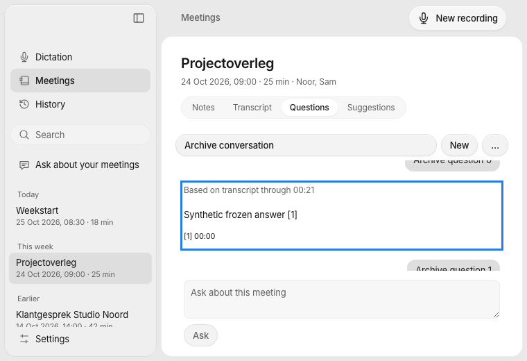
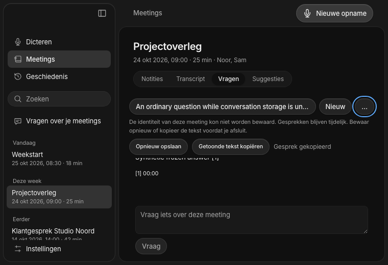
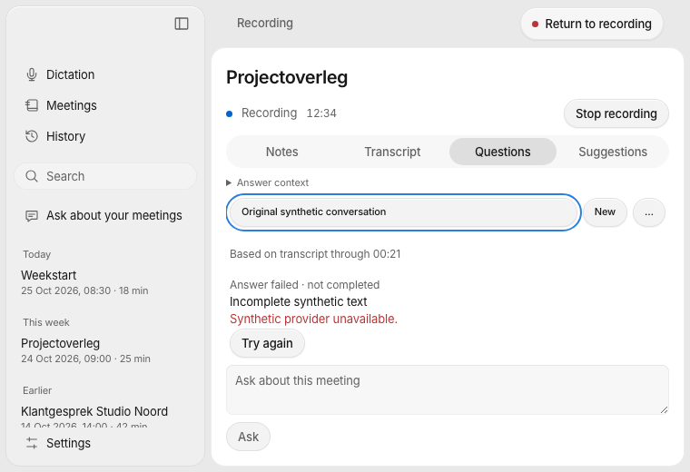
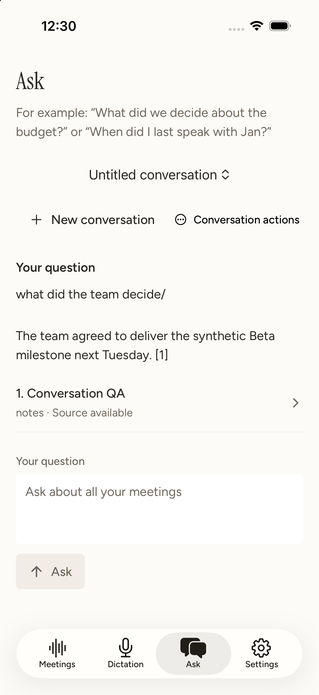
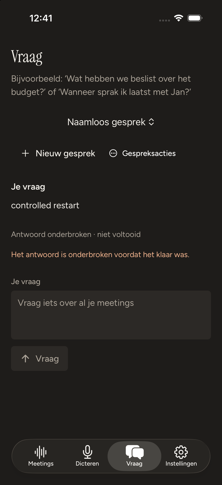

# Durable meeting conversations — 4 November 2026

Implementation for [#113](https://github.com/pennel-app/pennel/issues/113) and [#94](https://github.com/pennel-app/pennel/issues/94), in [PR #138](https://github.com/pennel-app/pennel/pull/138), stacked on tested/reviewable [#137](https://github.com/pennel-app/pennel/pull/137). The base is `3b6d0524a353fd671648652008ad270679814a9b`. Reviewed core/native candidate `65b5a7c` is unchanged in product `a6ec6f0a38769bed0a1bce3dcf3980c5c51784ba`, which also fixes a desktop title ellipsis and iPhone library empty-state copy. Evidence-only follow-up does not change product source. No merge or release is claimed.

## Behavior and compatibility

The Rust core owns versioned `conversations.sqlite`, stable meeting/library scopes, conversation/message/request IDs, selected conversation and draft revisions, bounded 50-row pages and asynchronous request lifecycle. Both desktop Ask implementations and the active Expo/iPhone meeting/library routes use five additive JSON/UniFFI APIs. Legacy stateless APIs remain compatible; there is no new mobile recording Ask surface.

Provider work freezes acknowledged notes, finalized transcript context, selected sources, immutable cutoffs and relevant attribution/name revisions. Capture/Stop never waits for model completion. Switching preserves the original target; cancellation before admission prevents dispatch, and late results cannot resurrect a deleted conversation/meeting or enter a replacement session. A restarted process marks pending responses interrupted rather than resuming them automatically.

The database is separate from canonical Markdown, search, meeting sync, export and future sharing/MCP contracts. Persistence failures preserve text with an unsaved reason, retry/copy and idempotent saves. Future schemas and corrupt records remain intact. Initial unreadable selections get a fresh recovery composer; explicit IDs fail closed. Read-only legacy meetings use temporary core-owned state until explicit retry can promote the same IDs and draft to a real meeting UUID. Promotion is deferred while its original request runs.

New conversation namespaces use an iOS sandbox-relative identity so container relocation does not hide history; desktop and external library namespaces retain absolute identity. Existing people-store namespaces remain byte-compatible: changing those requires its own guarded migration. No inferred name/content merge or automatic account/source enrichment is added.

## Verification

| Check | Result |
|---|---|
| `make core`, `make test` | Release core built; 1,043 core tests passed, 7 existing ignored; 17 keyboard tests passed |
| `cargo test --manifest-path core/Cargo.toml --no-default-features` | 1,026 passed, 5 existing ignored |
| Core/backend format and strict Clippy | Passed, including core default/lean and backend `--all-targets` |
| Desktop `npm ci`, `npm test`, `npm run build` | 312 tests and production build passed |
| `cargo test --manifest-path apps/desktop/src-tauri/Cargo.toml` | 269 passed |
| `swift test --package-path apps/macos-platform` | 146 passed |
| `make theme-check`; desktop packaging Python suite | Passed; 61 packaging tests |
| Owned fixture/capture safety suites | 50 JavaScript fixture and 11 Python capture-safety tests passed |
| Owned browser matrix | 108 passed: 22 conversation + 5 retained live cases × EN/NL × light/dark |
| `make mobile-test` | Typecheck, 17 plugin, 7 widget, 130 UI/controller and 116 Swift helper tests passed |
| Mobile clean/repeated Prebuild and native ownership | Passed after all five API additions; generated graph remains unchanged |
| Hosted generated iOS tests | 137 runtime/service + 36 keyboard = 173 passed on the owned iOS 27 simulator |
| Sequential unsigned ARM64 Release builds | Simulator and generic iPhoneOS passed |

Commands run from the repository root. Rust uses `scripts/with-toolchain.sh` and the existing personal compiler-storage guard/packed-symbol defaults. Large native commands use `/Users/landerparren/.local/bin/worktree-storage run --`. The mobile sequence uses `make mobile-test`, `make mobile-prebuild`, `make mobile-native-test IOS_DESTINATION='platform=iOS Simulator,id=7B0CD7FD-879B-49FF-BCD0-DA64090BD209'`, `npm --prefix apps/mobile run build:ios`, then `PENNEL_IOS_DESTINATION='generic/platform=iOS' npm --prefix apps/mobile run build:ios`. Native configurations run sequentially, with ad-hoc hosted-test signing and unsigned Release products.

Regressions cover request idempotency, original-conversation completion, cancellation before admission and reversed IPC responses, late results after deletion or replacement, pending-to-interrupted recovery, corrupted summaries/messages/generations, cross-row write isolation, future schemas, SQLite failures/retry, long-page/focused-source loading, source label/retranscription changes, root switching and legacy UUID migration. Read-only legacy tests prove ordinary Ask remains usable and explicit retry promotes the same conversation/message IDs and draft without writing folder hashes to SQLite.

The final desktop group is `build/verification/conversations-113/desktop/accepted-title-ellipsis/`. All 114 inputs stayed unchanged through 108 captures, SHA-256 `d7eef5519993f4931cf1fc4823b6e21d4557193eecce821bcc393dea3636b2b1`; the 105 product inputs hash to `3765c00ad7e643f30cccdff92a4b5340c3e3d0c59e8cb081200d65f1ad72a12b`. A separate comparison proves those inputs match committed product `a6ec6f0`. Cases exercise true Tab/Enter/Escape, draft reload, paging/source return, background completion, notes/admission/cancel races, interrupted/failed/unsaved states, both desktop Ask routes and retained Stop/new-meeting behavior. New cases use 760×520 and assert readable selectors, usable history, composer and complete submit-button bounds. No runtime errors, unknown IPC, unexpected surface banners, language mismatch or horizontal overflow were found. Eight targeted screenshots additionally verify long-title prefixes/ellipses in both appearances and languages.

The native 173-test run and final Release products share core/assets hash `2dc31f2834b40fe2b1d5015a5b97551ba17c5d9cea3ec0484ec4a55c38fb8ded`. The iPhone empty-state copy correction changes JavaScript only: type/UI checks and both Release bundles were rebuilt, with explicit equality of all core/Swift artifacts to the hosted run. Final mobile/shared input hash is `65cb57e5c194421ebe4b4849b4d2f54dc1904fecb630b038c0d1181230f2c3b6`. Simulator/device full-product hashes are `f38ec04e339ebf4e3fb0de410abb594741c34da0e57bcd7fe9f6bccc09372bf2` / `d58f9fc35f8a5ab24adb33cc9849afd6292feeb6ce803275ed319bb17445077a`. Canonical app, keyboard and widget plists preserve Preview bundle, App Group and Keychain identities.

Raw logs and earlier superseded candidates remain under ignored `build/verification/conversations-113/`. The final [machine receipt](conversations-113.json) records retained logs/artifacts and evidence limits. Earlier #102 and #113 products, core/typing artifacts, headers/bindings, dSYMs, XCResults and QA are preserved with hash-verified retention manifests; existing Xcode build/index/compiler caches were not deleted.

## Isolated iPhone simulator QA

The final private machine receipt is `build/verification/conversations-113/mobile/summary.json`; its privacy-safe aggregate is `build/verification/conversations-113/mobile/public-summary.json`. An owned derivative of the final simulator product uses the existing isolated `PennelQAProfile` with synthetic notes and a loopback fixture provider (`ollama` protocol, `pennel-fixture`). These are interface/lifecycle tests, not model quality or latency measurements. Screenshots use the assigned Device Hub route on iPhone 17/iOS 26.5.

EN/light and NL/dark controls, create/switch/rename, current citation navigation and exact-answer return, stale references with readable answers, and separate meeting/library scopes passed. Draft and selected history survived installing the updated QA product, with actual app-container UUID changes observed. This supports the sandbox-relative conversation key; it does not establish a signed physical-device upgrade.

A controlled third request remained held at the provider while only the QA app was terminated/reopened. The question returned with an interrupted assistant; total requests stayed at three through reopening and releasing the old handler. There was no automatic resend or late completed answer. A newer-format database fault showed localized unsaved/Retry/Copy states and remained byte-identical after Retry; its original QA database was restored afterward.

Restoration verified the exact prior Preview bundle manifest (`dd97eeb3ddd8e510d12332049f49471d20e22fd136a08797fbb9b6cd56c329ee`, 266 files) and all 13 original Core/Documents files. The normal app was left unlaunched. Owned Hub/mock processes and the separate Dia window were closed; the hosted simulator returned to its original Shutdown state. Normal data, credentials and provider choices were not used for QA. The derivative's profile/signature differs from canonical unsigned products and is recorded separately.

## Independent review

Two fresh reviewers compared `3b6d052...18b2c1a`, then checked the corrective commits `51c53ba` and `65b5a7c` with surrounding source. Both also checked the final two-line UI correction at `a6ec6f0` and found no additional actionable issue.

### Standards

The initial pass found one compatibility defect: changing the existing iOS people-store namespace would hide old rows. The correction preserves the old namespace and keeps the stable iOS identity for the new conversation store. Recheck: **0 remaining hard findings**, with no new privacy, ownership, language, branding, dependency, Android or signing violation.

### Spec

The initial pass found that valid SQLite files containing a corrupt selected summary/message could disable ordinary Ask. Recovery now creates a separate unsaved context without altering corrupt rows or another conversation. A follow-up caught negative persisted generations; those now use the same metadata-corruption category. Public regressions prove ordinary Ask works and explicit-ID operations never retarget. Final recheck: **0 remaining actionable findings** and no scope creep.

## Remaining acceptance

Owned browser fixtures, hosted tests and unsigned products do not establish physical iPhone, signed in-place upgrade, installed Windows/Linux, physical keyboard/IME/VoiceOver, real provider/acoustic/resource or production acceptance. No Cloud deployment, paid inference, real meeting/contact data or Android implementation is involved. Keep #113 OPEN / In review through review, merge and required acceptance.
