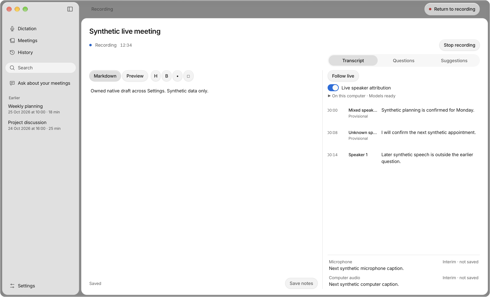
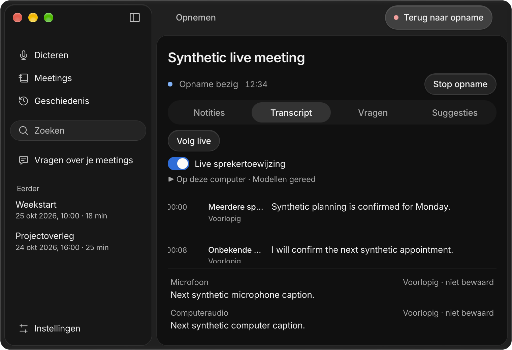

# Live speaker attribution — 3 November 2026

Implementation for [#99](https://github.com/pennel-app/pennel/issues/99), under [#94](https://github.com/pennel-app/pennel/issues/94), stacked on [#22 / PR #128](https://github.com/pennel-app/pennel/pull/128). The code candidate is `5d63a37` (`9bd5a0f` implements attribution; `5d63a37` adapts the inherited evaluation fixture). The personally signed desktop binary comes from `f987a57`; its only source difference from this candidate is the evaluation-only fixture repair. No ordinary desktop runtime source differs.

## Delivered contract

An explicit per-recording control starts off for every new session. Live attribution requires the selected local route and compatible installed models. Missing models, unsupported hosted routes, contention, cancellation and failure retain truthful status without substituting a provider or downloading assets.

Thirty-second windows start at least ten seconds apart. One physical worker processes both tracks sequentially, with one active and one replaceable pending batch. Rings plus owned snapshots are bounded to **11,520,000 bytes (11.52 MB)**; model, native inference, capture and transcription allocations are outside that bound. Twelve session centroids retain voice identity across toggle cycles; additional unmatched speech stays unknown. Authoritative speech and offline acoustic work take priority. Logical cancellation rejects late output while physical occupancy remains held until native inference exits.

Accepted audio is independent of interim-caption enablement. Exact authoritative chunk snapshots remain pinned while transcription has priority, including a delayed 30-second chunk whose rolling ring has advanced. Revisioned updates use durable utterance/source IDs, preserve valid manual corrections and never invent word alignment. Final acoustic processing reuses only unambiguous live identities; uncertain mappings stay unknown. Labels remain visibly provisional in desktop/iPhone review, evidence, summaries and exports until actual final processing settles them.

Provisional metadata uses manifest schema 2. Old schema-1 readers preserve it read-only. Ordinary save, rename, reopen and sync cannot silently clear the flag; actual final reconciliation can return the snapshot to schema 1. Both schema versions pass recovery at all three journal boundaries. PCM and centroids remain private.

## Verification

| Check | Result |
|---|---|
| Core release and default tests | Built; 880 passed, 7 existing ignored; 17 keyboard tests passed |
| Desktop frontend and backend | 274 frontend tests/build; 256 backend tests passed |
| Worker, attribution and acoustic regressions | 16 worker, 30 attribution and 15 acoustic tests passed; two real-model tests remain ignored |
| Formatting and strict Clippy | Core/default/lean, desktop backend, speaker ONNX and evaluation feature passed; core/backend formatting passed |
| Evaluation feature after inherited CI repair | 10 tests passed; deterministic canonical fixture identity retained |
| Recovery and metadata compatibility | V1/V2 × three interruption boundaries passed; ordinary-save regression observed failing, then passing |
| Theme, packaging and fixture helpers | 61 packaging and 32 fixture tests passed; theme passed |
| Mobile types/UI/plugins/widgets/helpers | Passed; 117 UI, 17 plugin, 7 widget and 116 portable Swift tests |
| Matching iOS libraries/bindings and clean/repeated Prebuild | Passed, including deployment pods and six ownership checks |
| Hosted iOS tests | 169 passed, no failures or skips; 177 device invocations include parameterized runs |
| Unsigned ARM64 Release builds | Simulator and device passed sequentially |

Targeted suites overlap the full suites; their counts are not additional totals. The full default core run preceded the evaluation-only repair; the fresh evaluation-feature run verifies that repair. Mac Swift source did not change after #22's 139-test verification.

Independent review and failing regressions drove fixes for retirement/toggle storms, pinned chunk boundaries, stable voice allocation, provisional persistence and selection during genuine timed splits. Twelve clear/move/Follow split renders and 32 existing workspace regression renders pass. The separate live matrix has 28 renders and review matrix eight, all EN/NL light/dark; minimum 760×520 and enlarged-text cases are included. These are owned Chromium fixtures with synthetic data, not acoustic accuracy measurements or physical keyboard/IME certification.

## Owned native evidence

Sixteen captures of the personally signed packaged macOS app exercise the explicit toggle, provisional labels, real isolated Markdown/settings storage, native Close/Finder reopening, retained notes and capture-first Stop. Capture/provider IPC, speaker inference and composition events are synthetic; no audio device, live provider or model was used.

Executable SHA-256: `16da5071688eb0bcc19ad4d0c9a91d547580670ade91fa42724adf6d1919413a`. Strict signing verification pins personal identity `26AD2732047AB5E2F5CB1B239B71806C54EB3026`, team **B538Q2K76C**. Reproduce with `python3 -B scripts/verify-live-speakers-native.py --window-helper <owned-window-helper> --locale both --appearance both --output build/issue99/native-qa`.

Exact commands, logs, native assertions and check scope are in [the machine-readable receipt](live-speakers-99.json). Native builds use `/Users/landerparren/.local/bin/worktree-storage run --`; iOS configurations run sequentially. Existing build products, symbols, baseline app and QA artifacts remain retained. No cache guard was bypassed and no model, provider, credential or production setting was changed.

## Remaining acceptance

No real-speaker accuracy, attribution latency, revision churn, transcription lag, CPU or aggregate RSS measurement is claimed. Compare `main@340d02e` and the candidate on identical owned/consented EN, Dutch/Flemish and mixed recordings: rapid turns, short acknowledgments, overlap, similar/unknown voices, shared microphones and hybrid calls. Verify live inference usage, Stop/input responsiveness, resource pressure and queue bounds on actual hardware. Keep #5/#47 route/echo acceptance, long-session #12, installed Windows/Linux, signed iPhone, VoiceOver/physical IME and review/merge gates open. No release or deployment occurred.
