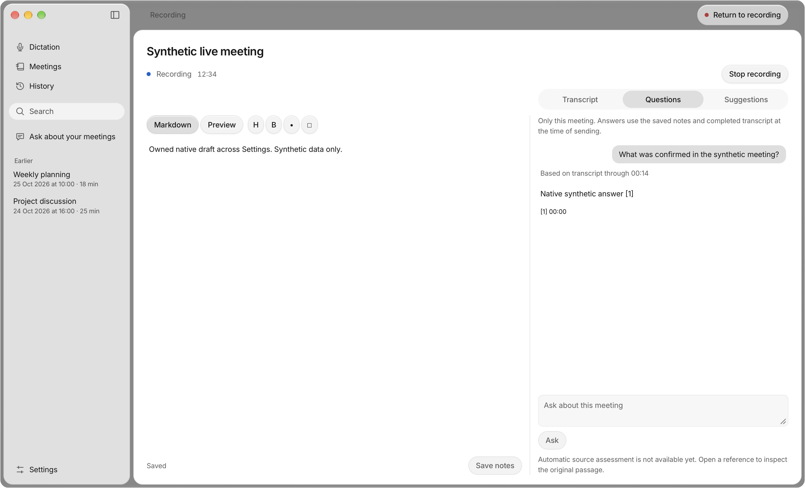
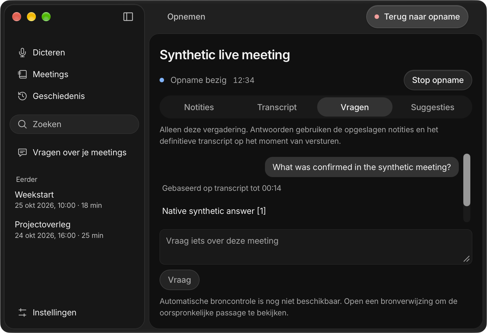
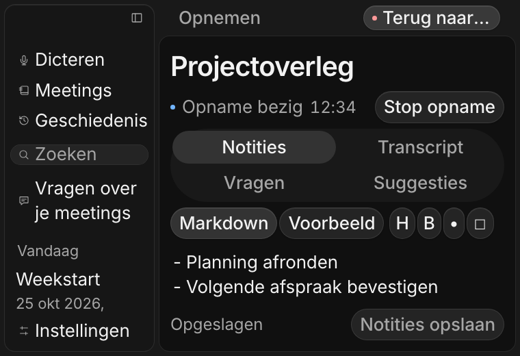

# Live meeting workspace — 2 November 2026

Local implementation and verification for [#95](https://github.com/pennel-app/pennel/issues/95), under [#94](https://github.com/pennel-app/pennel/issues/94). This receipt records repository tests, isolated frontend fixtures and an actual packaged macOS window. Real meeting, hardware and installed-platform acceptance remain separate.

## Delivered behavior

The existing main window retains one meeting workspace through recording, processing, source inspection and review. Markdown source, preview and formatting helpers share the same editor; transcript and question updates do not replace it. At 800 px available content width the initial split is 60/40; smaller widths use four tabs. Pane choice, editor selection, transcript following, conversation and composer survive navigation and finalization. Existing summary, audio, speaker, retranscription and export actions remain reachable through Review and export, with a return to the retained workspace.

Stop acknowledges actual capture quiescence before frontend flushing, note persistence, archive drainage, transcription or model completion. Notes and question snapshots use session gates independent of capture. Both non-Mac capture sources receive stop before either is joined; Mac quiescence bypasses diagnostics I/O and drains writers outside AppKit's main queue. Failed saves retain drafts and do not restart capture. Rename writes metadata before relocating the folder, preserving the original path on a failed metadata write.

Questions save their latched notes before admission, then freeze finalized transcript, acknowledged notes, provider configuration, source numbers and cutoff. Later typing and transcript appends cannot change that evidence. Cancelled requests reject late results while physical work retains its resource lease until it actually exits. Answers may complete after Stop, rename or a following meeting and remain attached to their original UID/session. Numbered anchors distinguish repeated notes and survive ordinary Markdown transcript normalization; changed sources retain their frozen excerpt with an explanation.

Existing Ask/UniFFI interfaces and mobile Markdown storage remain compatible. The desktop bridge adds live-question begin/cancel commands, request-scoped results, stable meeting UID metadata and an optional session guard on Stop. No dependency, provisional recognition transport, automatic decision processing, background analysis or durable chat store was added.

## Local checks

| Check | Result |
|---|---|
| `make core && make test` | Release core built; 766 core tests passed, 7 existing ignored; 17 keyboard tests passed |
| Desktop `npm ci`, `npm test`, `npm run build` | 251 unit tests and production build passed |
| Desktop backend `cargo test` | 237 passed |
| Core formatting and `cargo clippy --lib --tests -- -D warnings` | Passed |
| Backend formatting and `cargo clippy --all-targets -- -D warnings` | Passed |
| `swift test --package-path apps/macos-platform` | 124 passed |
| `make theme-check` | Passed |
| `python3 -B -m unittest discover -s scripts/tests -p 'test_desktop_*.py'` | 61 passed |
| `node --test scripts/fixtures/desktop-platform.test.mjs` | 28 passed |

Rust commands used `scripts/with-toolchain.sh`; native builds used the storage guard. The stored command logs are under ignored `build/issue95/`. Hosted CI is recorded on the pull request separately.

Meaningful regressions cover blocked/failed notes and archives, failed frontend flush, both capture tracks, finalizing snapshots, failed rename metadata/move, provider/source freezing, physical cancellation capacity, duplicate citations, Markdown storage round trips, concurrent composition/transcript/answers, delayed results, source validation races, Settings/setup, hide/reopen, review/export and a following meeting. Independent review exposed finalization focus loss, stale status resurrection and source identity problems; these now have targeted regressions.

## Frontend fixtures and timings

All 187 owned scenarios passed in EN/NL and light/dark: **748 renders**, with no runtime errors, unknown fixture commands, unexpected banners or horizontal overflow. The complete sweep contains 728 renders; the subsequently added duplicate-source/review and Windows/Linux parity cases add 20. Minimum 760×520, wide layout, breakpoint changes, actual doubled text sizes and reduced motion are included. Platform fixtures exercise shared UI behavior; they do not establish installed Windows/Linux acceptance.

An accelerated sixty-minute transcript fixture adds 240 finalized rows in five batches while typing, saving, answering and stopping. `performance.now()` measurements and their sample counts are in the accompanying JSON. These are fixture timings, not speech recognition, provider or hardware capture benchmarks. Native QA similarly records synthetic capture-off timing only.

Reproduce with `node scripts/capture-desktop-reference.mjs`; the relevant added scenarios begin with `live-workspace-`. Each scenario owns its browser context and synthetic data. Full manifests remain under `build/issue95/full-sweep-final/`, `duplicate-review/` and `platform-parity/`.

## Packaged native app

The capture Preview was built and launched on Mac16,8 / Apple M4 Pro / macOS 27.0.1. Its personal Apple Development signature was explicitly pinned to team **B538Q2K76C** and passed strict verification. Executable SHA-256: `2402620ff5be8ffa794473a4fd343d7dd11b1ee6547dbe17ed0192b1377a1e1d`.

Four locale/appearance sessions produced **16 owned native window screenshots**, including 1400×850 and 760×520. Native and frontend Liquid Glass metadata, locale, appearance, window ownership and lack of overflow were checked for every image. The native harness verifies real isolated Markdown persistence, Settings/back, actual Close/hide and Finder reopening of the same process/window. It also checks editor focus/composition/selection during transcript and answer updates, cited sources/back, finalization without blurring the editor, failed-save Stop, response-after-Stop and recovery into real stored notes.

The packaged production frontend and native chrome are real. Live capture and provider responses use a capture-only synthetic IPC fixture; no microphone or system audio device is opened. Composition events are injected, so this does not establish physical keyboard/IME acceptance. The initial real stored-meeting checks and final recovery writes use the actual backend and isolated local Markdown.

Build and run commands used:

```sh
# From apps/desktop; the identity is the verified personal certificate.
/Users/landerparren/.local/bin/worktree-storage run -- \
  env APPLE_SIGNING_IDENTITY=26AD2732047AB5E2F5CB1B239B71806C54EB3026 \
  ../../scripts/with-toolchain.sh npx tauri build --bundles app \
  --config src-tauri/tauri.capture.conf.json

# From the repository root, with the owned window helper from the capture harness.
/Users/landerparren/.local/bin/worktree-storage run -- \
  python3 -B scripts/verify-live-workspace-native.py \
  --window-helper build/issue95/native-window-helper \
  --locale both --appearance both --output build/issue95/native-route-final
```

The helper uses the existing `WINDOW_CHECK` program in `scripts/capture-desktop-windows.py`; it was compiled through the storage guard and signed with the same personal identity. The retained app is `apps/desktop/src-tauri/target/release/bundle/macos/Pennel Capture Preview.app`. The native harness refuses another app identity/team and never falls back to production data. Complete receipts and screenshots remain under `build/issue95/native-route-final/`; earlier runs were retained.







## Remaining acceptance

Keep #95 open/In review through review and merge. Real calls, microphone/system routes, audible capture-stop timing, physical IME/accessibility, installed Windows/X11/Wayland behavior and real sixty-minute audio/resource measurements retain their existing acceptance owners, particularly [#5](https://github.com/pennel-app/pennel/issues/5), [#6](https://github.com/pennel-app/pennel/issues/6), [#12](https://github.com/pennel-app/pennel/issues/12) and [#49](https://github.com/pennel-app/pennel/issues/49). No release, installation over production, service deployment or real-meeting acceptance is claimed. New interim captions (#17), suggestions (#97), scheduling (#98), speaker quality (#22/#99) and restart-persistent conversations (#113) remain separate.
