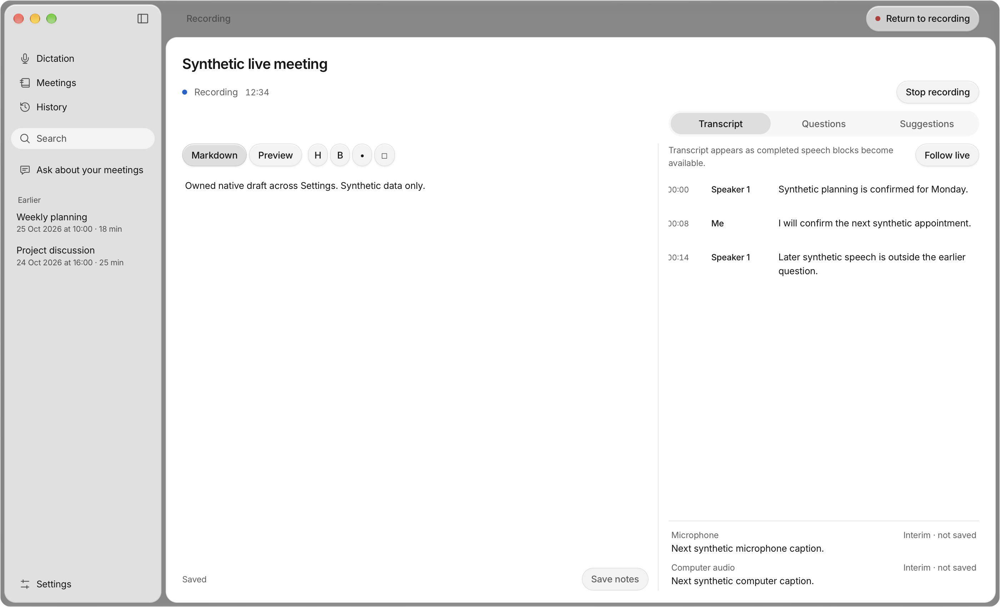
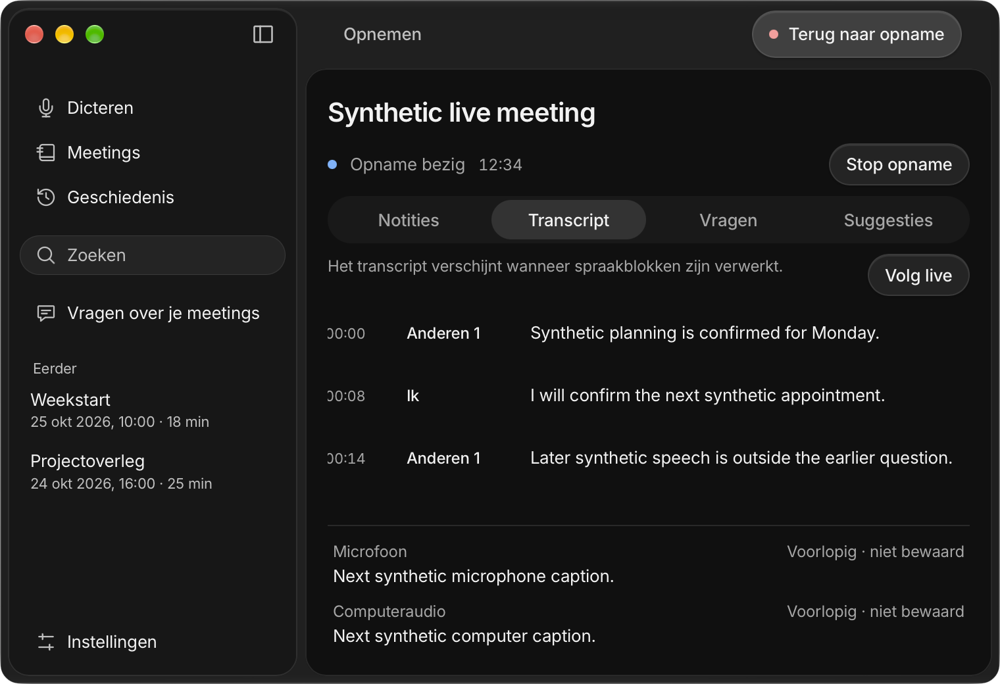

# Interim meeting captions — 3 November 2026

Candidate `73cbb7f5798db5dcc79cc11db8b8553fb4a26cd7` implements [#17](https://github.com/pennel-app/pennel/issues/17) on merged #95/PR #126. This records repository, owned-fixture and packaged-native evidence; real speech/device acceptance remains open.

Microphone and computer-audio captions are separate display-only lines. Local previews reuse the frozen, already loaded meeting model with bounded six-second audio, three-second scheduling and authoritative/dictation preemption. Apple previews use timed callbacks, installed assets only and bounded physical analyzer accounting. Unsupported routes retain final chunks. One shared live-text preference defaults on and survives mobile settings patches. Capture-first Stop and retained notes/questions remain intact.

Preview text never enters finalized segments, persisted meeting files, question evidence, summaries, export or sync. Epochs, finalized-range guards and atomic snapshots reject stale callbacks. Independent review found and repaired analyzer rollover contention, a suppressed-microphone transition race and late-final revival; focused regressions cover each.

## Verification

| Check | Result |
|---|---|
| `make core && make test` | Release built; 778 core tests, 7 existing ignored; 17 keyboard tests passed |
| Desktop `npm ci`, `npm test`, `npm run build` | 255 tests and production build passed |
| Backend `cargo test` | 244 passed |
| Core/backend formatting and strict Clippy | Passed |
| `swift test --package-path apps/macos-platform` | 133 passed |
| Theme, packaging, fixture-unit checks | Passed; 61 packaging and 29 fixture-unit tests |
| `make mobile-test` | Types, UI, plugins, widgets and portable Swift helpers passed |
| `make mobile-core` | Matched device/simulator libraries and Swift bindings generated |
| Mobile `test:prebuild`, deployment pod install, `test:pods` | Clean/repeated generation and pod ownership passed |
| `make mobile-native-test` | Hosted iOS simulator tests passed |
| Mobile `npm run build:ios`, then `PENNEL_IOS_DESTINATION=generic/platform=iOS npm run build:ios` | Both unsigned ARM64 Release builds passed |

Rust commands used `scripts/with-toolchain.sh`. Native commands ran through `/Users/landerparren/.local/bin/worktree-storage run --`. Exact logs remain under ignored `build/notetaker-2026-11-03/`; the machine-readable receipt contains measurements and acceptance limits. No model downloads, paid inference or production credential/provider changes occurred.

## Owned interface and timing evidence

Twenty-eight new EN/NL light/dark browser renders passed, including both tracks, final reconciliation, simultaneous IME/typing/questions/source return, Stop, unavailable states, minimum size and enlarged text.

A matched twelve-render sweep of existing long-session/concurrency/failed-save scenarios passed on archived `340d02e` sources and this candidate. Input-to-next-frame p95 was 17.4–18.3 ms at baseline and 16.8–18.2 ms for the candidate. Each long-session fixture has 50 input samples and five finalized-render samples. These accelerated fixtures do not measure acoustic preview cost, hardware capture or provider latency. The command maximum RSS was 300,023,808 versus 300,269,568 bytes; this is not aggregate application/model/process-tree memory.

Sixteen actual packaged macOS window captures passed EN/NL and light/dark, with real isolated Markdown saves, Settings/back and native Close/Finder reopening. Preview/capture/provider IPC and composition events were synthetic; no microphone or system-audio device was opened. The verified personal Apple team was **B538Q2K76C**; executable SHA-256 `8cea3dfc39b80c9fee13ee606d6d7696b1e691275f85f19e2a26c82ffd259118`.

Reproduce the native fixture with `python3 -B scripts/verify-meeting-captions-native.py --window-helper build/issue95/native-window-helper --locale both --appearance both --output build/notetaker-2026-11-03/native-captions`. The harness requires the owned capture Preview and personal team, and cannot start actual capture.

## Remaining acceptance

Measure actual selected-local/Apple first-caption/update latency, authoritative transcription and concurrent dictation latency, capture Stop, queue bounds, CPU and aggregate RSS on the same owned/consented two-track recording with captions disabled/enabled. Keep route/echo/device and long-session evidence with #5/#12/#47. Physical IME/accessibility and installed Windows/Linux acceptance remain separate. Keep #17 open/In review while these gates and review/merge remain. No release or deployment is established.
