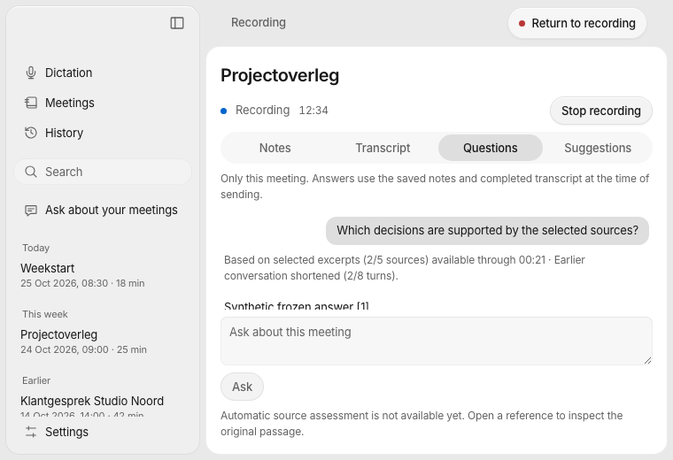
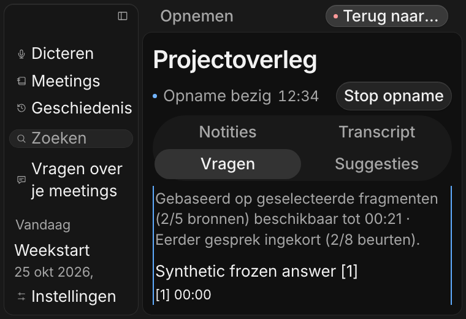

# Meeting inference scheduling — #98

This phase extends the retained #95 question worker and #54 transport for
[#98](https://github.com/pennel-app/pennel/issues/98), under
[#94](https://github.com/pennel-app/pennel/issues/94). It stacks on the empty-by-default
qualification contract in [PR #130](https://github.com/pennel-app/pennel/pull/130).
The [machine receipt](meeting-scheduling-98.json) records commands, candidates,
fixture captures, source/log hashes and remaining acceptance.

## Contract

- A shared physical inference pool permits two workers in total and at most one
  optional manual/background worker. Foreground questions keep a reserved slot.
  Speech demand cancels optional work, then foreground questions and explicit
  analysis take priority over queued background work. Capture/Stop and authoritative
  speech never acquire an optional-analysis lock.
- Logical cancellation and physical exit are different states. Transport permits,
  observers and retained library owners survive until the underlying worker exits.
  `InferenceCancellation::retain_until_physical_exit` registers a weak attachment;
  actual workers hold their own strong references. The cancellation token's registry
  does not itself own library leases after completion.
- One absolute deadline starts at admission and travels through queuing, credential
  refresh and transport. Frozen configuration/account/key epochs are checked before
  dispatch and after completion. No new client, provider substitution or retry path
  is introduced.
- `MeetingAnalysisCoordinator<T>` owns one active and one replaceable pending
  background snapshot per meeting. Starts are at least 60 seconds apart, using actual
  dispatch time. Cooldown survives toggles/pruning; no catch-up burst or automatic
  retry of an unchanged failed/cancelled snapshot occurs. A changed processing setup
  pauses background work until fresh off/on consent.
- Background admission also requires explicit enablement, exact #96 qualification,
  a visible workspace, healthy capture, caught-up transcription and available speech
  and foreground resources. The production registry is empty, so background and
  #97 suggestions remain unavailable.
- Meeting UID/session and replacement epoch distinguish append from replacement.
  Valid frozen foreground answers survive append, Stop and rename. Cancellation,
  account/configuration changes, source replacement and same-UID session replacement
  reject stale results. Content stays behind meeting-owned APIs; admissions carry
  identity and status records expose state, revision, reasons and bounded counts.

`meeting_analysis_resource_demand` exposes owned speech/foreground status through
UniFFI. Coordinator admissions and the existing prepared-question APIs carry the
deadline and cancellation contracts to downstream consumers. The standalone
completed-meeting compatibility path remains separate; this phase does not claim
that every historical generative call uses the meeting worker pool.

## Source selection and interface

Live question snapshots declare whole-meeting or selected-excerpt scope, available
and included source counts, and shortened conversation counts. The declared cutoff
remains frozen while later evidence arrives. Apple budgeting rebuilds both guards
and citation anchors from exactly the complete sources actually sent. The current
question is refused before source/history selection when it cannot fit; it is never
silently clipped.

The EN/NL disclosure is tested while notes and selection change and a frozen answer
finishes. Required minimum-size/enlarged-text review exposed a zero-height Questions
history. Two scoped CSS rules make the enlarged pane scroll while retaining history
height. The regression failed first, then passed with disclosure/source navigation,
return position and Stop reachable at 760 × 520 with doubled text. Screenshots are
owned Chromium fixtures, with synthetic capture/provider events and DOM input;
they are not native acoustic, physical IME or installed-platform evidence.

## Verification and remaining acceptance

Blocked-worker tests cover priority, the global two/optional one limits, cancellation
without early permit release, retained owners, absolute deadlines, bounded coalescing,
60-second starts, renewed consent, invalidation and no replacement/retry storm.
Independent bounded static review approved the scheduler and the final source-scope
fix; exact commands and results are in the receipt.

The first full lean run exposed a fixture race: another parallel speech test could
legitimately cancel the optional worker after admission but before its closure sent
the startup signal. The test now runs its exact case in a bounded subprocess using
the same production pool and original assertions. The repaired full lean suite passes;
the original failing log and diagnosis remain recorded. Production scheduling behavior
and limits were unchanged by this test-only repair.

Native generated Swift declarations and an isolated Preview ABI probe verify the
additive interfaces. Upstream #99 and downstream #57 native app/CNG/device builds are
separate candidates, not exact-head #98 native acceptance. Required exact-head CI,
merge, signed physical iPhone and installed Windows/Linux remain open.

Compare the same owned/consented recording against `340d02e` before activating
background work: actual inference usage, p50/p95 latency, CPU/aggregate RSS, queue
bounds, transcription lag, typing/selection/IME responsiveness and immediate Stop.
No such long-recording or model/resource pass is claimed. No model was downloaded,
substituted or evaluated, no paid request was made, and no release or deployment is
established by these fixtures. Keep #98 In review and #97 gated.
