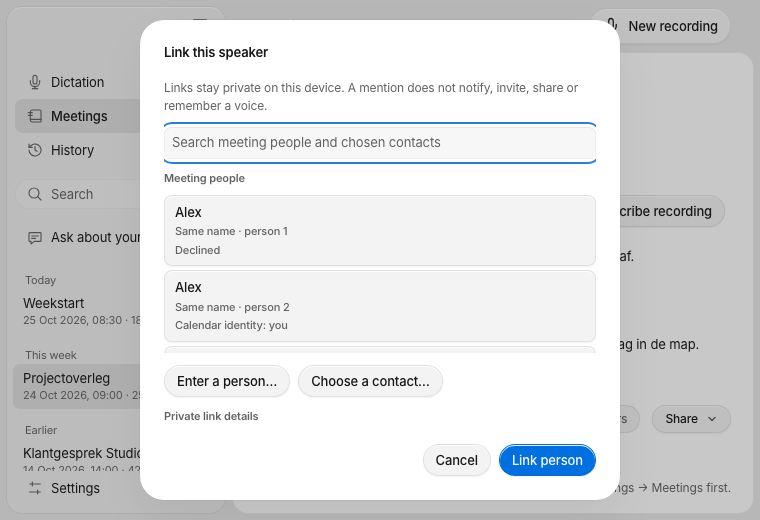
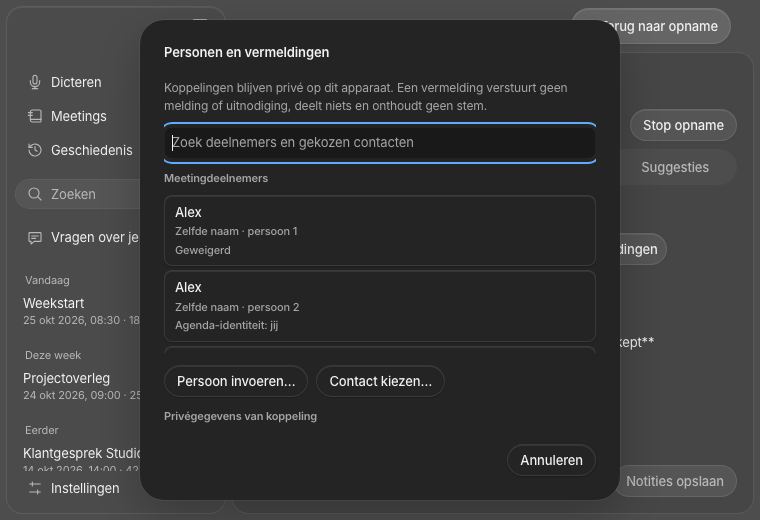
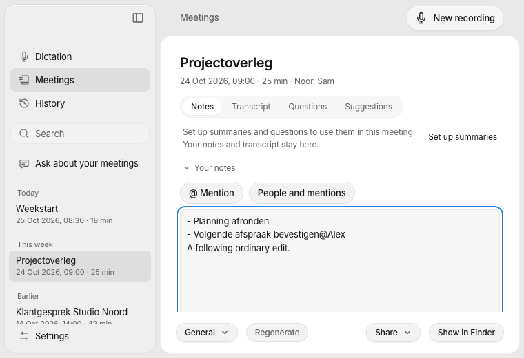

# Explicit people and mentions — 4 November 2026

Implementation for [#102](https://github.com/pennel-app/pennel/issues/102), under [#94](https://github.com/pennel-app/pennel/issues/94), in [PR #137](https://github.com/pennel-app/pennel/pull/137). Product candidate `a16628aa9e679adfdd114829f37c25c547b466da` is based on main `97a1bf89dab7d17776bd9bf14433746961cbfd78`; the subsequent receipt commit changes documentation/images only. Merge and installed-platform acceptance remain separate.

## Behavior and privacy

The shared Rust core keeps versioned `people.sqlite` outside meeting directories, partitioned by library context and stable meeting UUID. Person UUIDs are independent of names, contact identifiers, folders, acoustic clusters and voiceprints. Existing attendee strings and plain Markdown remain readable. The additive JSON/UniFFI interface owns explicit participant, alias, speaker-link and mention actions with expected revisions. Speaker associations retain exact utterance/source anchors; changed or missing evidence requires review.

The calendar bridge retains legacy fields while adding optional source/event/instance and attendee identity/status snapshots. A recording prompt revalidates its saved source snapshot before attaching it. The macOS contact picker returns only an explicitly selected contact snapshot, with no ongoing Contacts-store authorization or enumeration. Contact cancellation, owner closure and late callbacks do not mutate a meeting. The shared picker preserves manual entry on every desktop platform; Windows/Linux explain that the native contact source is unavailable.

Linking does not rename canonical speakers, enroll a voice, notify a contact, add an attendee or share content. Private contact aliases, e-mails and identifiers remain local. The safe projection contains authored mention text rather than contact enrichment. Existing Markdown export and encrypted meeting sync do not include either the private database or its associations.

Mentions use ordinary readable Markdown and exact byte/revision anchors. A prepared local receipt precedes the notes write; recovery distinguishes an unwritten edit, a confirmed insertion and a conflicting later edit. If notes are saved but metadata acknowledgement fails, the UI keeps the saved text and reports pending confirmation. Link removal leaves the visible text untouched.

## Verification

| Check | Result |
|---|---|
| `make core`, `make test` | Release core built; 1,012 core tests passed, 7 existing ignored; 17 keyboard tests passed |
| `cargo test --manifest-path core/Cargo.toml --no-default-features` | 995 passed, 5 existing ignored |
| Core/backend `cargo fmt -- --check`, strict Clippy | Passed, including core lean Clippy and backend `--all-targets` |
| Desktop `npm ci`, `npm test`, `npm run build` | 298 tests and production build passed |
| `cargo test --manifest-path apps/desktop/src-tauri/Cargo.toml` | 265 passed |
| `swift test --package-path apps/macos-platform` | 146 passed, including 7 new source/picker regressions |
| `make theme-check`; desktop packaging Python suite | Passed; 61 packaging tests |
| `node --test scripts/fixtures/desktop-platform.test.mjs` | 39 passed |
| Owned browser matrix | 60 passed: 15 cases × EN/NL × light/dark, all 760×520 |
| `make mobile-test` | Typecheck, 17 plugin, 7 widget, 121 UI/controller and 116 Swift helper tests passed |
| `make mobile-prebuild` | Clean/repeated non-clean generation and 6 actual pod/source/linker ownership checks passed |
| `make mobile-native-test IOS_DESTINATION='platform=iOS Simulator,id=7B0CD7FD-879B-49FF-BCD0-DA64090BD209'` | 135 runtime/service + 36 keyboard tests passed on the owned iOS 27 simulator |
| `npm --prefix apps/mobile run build:ios` | Unsigned ARM64 simulator Release build passed |
| `PENNEL_IOS_DESTINATION='generic/platform=iOS' npm --prefix apps/mobile run build:ios` | Unsigned ARM64 iPhoneOS Release build passed |

Rust commands use `scripts/with-toolchain.sh`, with the existing personal compiler-storage guard and packed-symbol policy. Large native commands use `"$HOME/.local/bin/worktree-storage" run --`; native configurations run sequentially. Hosted tests use the documented ad-hoc signing; Release candidates are unsigned. No production install or work signing identity is involved.

The final browser receipt is `build/verification/people-102/accepted-ui-reviewed-ack/ui-receipt.json`. All 104 inputs remained unchanged during capture and exactly match the committed product candidate; aggregate SHA-256 is `d2b82412683ead146f247139ba0d70016a27a23bc0249916baf2fb68d9f3d840`. The matrix covers both editors, duplicate/calendar identities, selected-contact confirmation, stale results/composition, real Chromium Tab/Enter/Escape and delayed writes through dismissal, hide, navigation, Stop and a replacement session. No runtime errors, unknown IPC, language mismatch, unexpected banners or horizontal overflow were observed.

The final mobile receipt is `build/verification/people-102/mobile/summary.json`. Core libraries were actually rebuilt after review corrections; headers match between device and simulator. All final preparation/test/Release phases share complete input hash `b3a1a93a575c4b087ba4c309e00a1d529fd4faece175678122d28fc9c2909422`, including referenced locale/JSON/audio inputs. The generation graph was checked after the four exported API additions; subsequent JSON behavior and locale fixes retained those same exports and generated ownership graph.

Simulator executable/full-product hashes are `5cc1ca4fb7a111973a38038784a8dad40cfc3a2c74261f6d6b1cc356429dfe5a` / `40c72954483545a493c4fe2ed660d92a05d27e44075a137b112c0c81f28aa5bd`. iPhoneOS hashes are `d42a8ce5bff53b5afce82337abfc8d6f755cd456357f6bae54939935f131fc95` / `7e3c13080c48a2eb73ad432d6074ec7a3be2f01713d1575969abe02db3e79e57`. Actual app/keyboard/widget plists retain Preview bundle, App Group and Keychain identities. No mobile source or generated project was committed.

Raw logs and intermediate failed/passing runs remain under ignored `build/verification/people-102/`, with Mac logs at `build/verification/people-native*.log`. The [compact machine receipt](people-links-102.json) records final checks and boundaries. Earlier candidates are retained and superseded explicitly.

## Independent review

Two fresh reviewers compared `97a1bf89...8482dd6`, then rechecked `8482dd6...a16628a` and surrounding source independently.

### Standards

The initial pass found four hard issues: the missing mention-relink notes revision, lost acknowledgement after insertion dismissal, skipped calendar authorization when source identity was unknown, and untranslated native picker failures. All were repaired and rechecked: **0 remaining hard findings**. Optional finite-state enum feedback was reviewed against the existing JSON bridge convention; no refactor was required. No new dependency, work identity, Android or broad address-book access breach was found.

### Spec

The initial pass found three issues: insertion dismissal could lose an already-saved note acknowledgement; every real mention relink omitted a required field; and source authorization was not checked again before mutation. Corrections include public core/backend and delayed browser regressions. The recheck reports **0 remaining actionable spec findings**, with no scope creep.

## Remaining acceptance

Owned fixtures and synthetic native contacts do not establish physical keyboard/IME, VoiceOver, real-calendar/contact permissions, installed Windows/Linux behavior or signed-device upgrade acceptance. No real contacts, meeting content, production data, provider credentials, Cloud deployment or Android implementation are involved. Keep #102 open/In review through review, merge and required acceptance.
