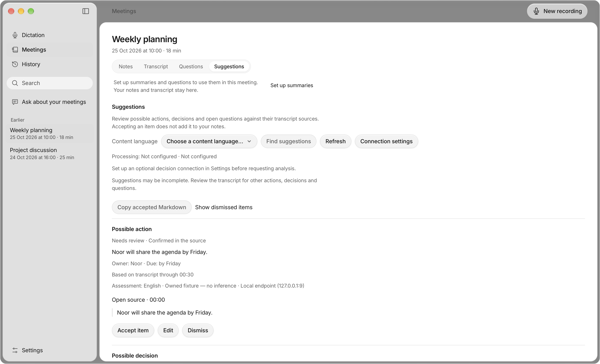
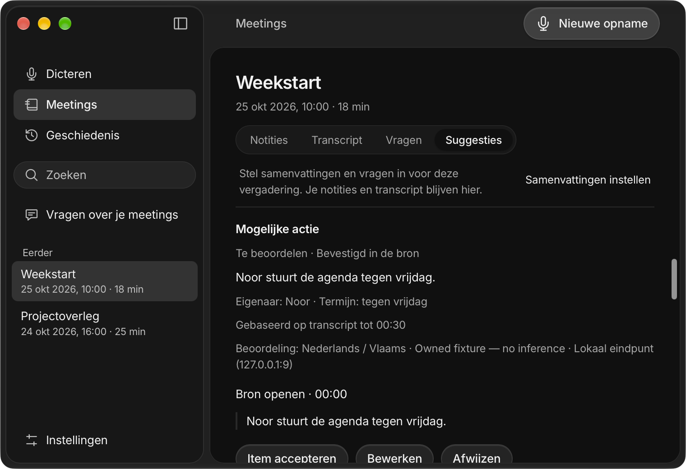

# Durable meeting review — #57

Prepared on 3 November 2026 for [#57](https://github.com/pennel-app/pennel/issues/57) and [#94](https://github.com/pennel-app/pennel/issues/94), stacked on [#131](https://github.com/pennel-app/pennel/pull/131) at `748e017`. The final implementation/build candidate is `6179331`; the delivery commits add verification artifacts and a corrected observer in the QA helper. No product source changes follow that candidate.

The single versioned `insights.json` store retains source-linked proposals, user edits, accepted/dismissed state, edit claims, source history and note-insertion receipts. Desktop and Expo/iPhone expose the same finished-meeting review, source navigation, reassociation and accepted Markdown export. Explicit analysis qualifies and freezes evidence/configuration before native key reads; cancellation retains physical accounting until work exits. The production qualification registry remains empty. Live suggestions and background updating remain unavailable under #97.

Accepted export preserves an edited item body byte-for-byte, then appends separately labelled original evidence: the relative transcript-file reference, durable identities/fingerprint, exact quote and UTF-8 range, timestamps/cutoff, sanitized processing destination and current/stale status. The relative reference requires the meeting folder; it does not claim an application deep link or a Markdown row anchor. Add to notes uses the separate exact edited Markdown contract and ordinary durable notes writer. Export provenance cannot alter receipt hashes or silently append itself to notes.

## Verification

The [machine receipt](reviewed-insights-57.json) records counts, hashes, exact candidate boundaries, native checks and comparison data. Full logs and result bundles remain under `build/issue57/`; earlier products, dSYMs and bindings are retained with APFS clones in `build/issue57/retained-pre-exporter`.

| Check | Result |
| --- | --- |
| Core default / lean | 974 passed + 7 ignored / 957 passed + 5 ignored |
| Rust evaluation feature | 10 passed; strict Clippy passed |
| Core release, formatting, strict default/lean Clippy | Passed |
| Keyboard / speaker ONNX | 17 passed / 15 passed + 1 ignored; strict checks passed |
| Desktop frontend / backend | 291 passed + production build / 258 passed + strict Clippy |
| Mac Swift / mobile portable helpers | 139 passed / 116 passed |
| Mobile type/UI/plugins/widgets | Passed / 121 / 17 / 7 passed |
| Clean and repeated non-clean Prebuild / pods | Passed / 6 passed; generation inputs unchanged by final pure Rust export fix |
| Current mobile Rust + Swift bindings | Rebuilt for both ARM64 targets; binding hash unchanged after export-only change |
| Current hosted iOS native tests | 171 passed, 0 failed, 0 skipped; valid result bundle |
| Current iOS Release builds | Simulator then iPhoneOS ARM64 passed sequentially, unsigned Preview identities |
| Theme / packaging / fixture helpers | Passed / 61 / 34 passed |
| Offline evaluation | 287 passed; 4,500-case replay, 12 candidate records, 0 adopted |

Core/default, lean, evaluation and backend commands:

```sh
make core
scripts/with-toolchain.sh cargo test --manifest-path core/Cargo.toml --lib
scripts/with-toolchain.sh cargo test --manifest-path core/Cargo.toml --no-default-features --lib
scripts/with-toolchain.sh cargo test --manifest-path core/Cargo.toml --bins
scripts/with-toolchain.sh cargo test --manifest-path core/Cargo.toml --doc
scripts/with-toolchain.sh cargo test --manifest-path core/keyboard/Cargo.toml
scripts/with-toolchain.sh cargo fmt --manifest-path core/Cargo.toml -- --check
scripts/with-toolchain.sh cargo clippy --manifest-path core/Cargo.toml --lib --tests -- -D warnings
scripts/with-toolchain.sh cargo clippy --manifest-path core/Cargo.toml --no-default-features --lib --tests -- -D warnings
scripts/with-toolchain.sh cargo clippy --manifest-path core/Cargo.toml --features evaluation --lib --tests -- -D warnings
scripts/with-toolchain.sh cargo test --manifest-path core/Cargo.toml --features evaluation evaluation::
scripts/with-toolchain.sh cargo clippy --manifest-path core/speakers/Cargo.toml --all-targets --features onnx -- -D warnings
scripts/with-toolchain.sh cargo test --manifest-path core/speakers/Cargo.toml --features onnx
scripts/with-toolchain.sh cargo clippy --manifest-path apps/desktop/src-tauri/Cargo.toml --all-targets -- -D warnings
scripts/with-toolchain.sh cargo test --manifest-path apps/desktop/src-tauri/Cargo.toml
```

The frontend ran `npm test` and `npm run build` in `apps/desktop`. Mobile ran `npm run typecheck`, `test:ui`, `test:plugins`, `test:widgets`, `test:prebuild` and `test:pods` in `apps/mobile`; `make mobile-prebuild` performed matched Rust preparation, clean/repeated generation and deployment-locked pods. `swift test --package-path apps/macos-platform`, `swift test --package-path apps/mobile/native/ios/MobileKit`, `make packaging-test`, `python3 scripts/generate-theme.py --check`, `node --test scripts/fixtures/desktop-platform.test.mjs` and `python3 -B -m unittest discover -s evaluations/decision-models/tests` passed.

The final export-only Rust change rebuilt `make mobile-core`, reused the unchanged generated projects, and then ran:

```sh
/Users/landerparren/.local/bin/worktree-storage run -- bash scripts/ci-xcodebuild.sh test \
  -workspace apps/mobile/ios/Pennel.xcworkspace -scheme Pennel -configuration Debug \
  -destination 'platform=iOS Simulator,id=64C462E2-0904-4E38-98C0-F1F19690D2E4' \
  -derivedDataPath apps/mobile/build/Issue57TestDerivedData \
  -resultBundlePath build/issue57/native-export-tests.xcresult \
  CODE_SIGNING_ALLOWED=YES CODE_SIGN_IDENTITY=- CODE_SIGN_STYLE=Manual DEVELOPMENT_TEAM=
/Users/landerparren/.local/bin/worktree-storage run -- bash scripts/build-mobile-ios.sh
PENNEL_IOS_DESTINATION='generic/platform=iOS' /Users/landerparren/.local/bin/worktree-storage run -- bash scripts/build-mobile-ios.sh
```

The isolated Preview app and extensions retain their separate data/credential identities. Device builds used `CODE_SIGNING_ALLOWED=NO`. The simulator test host was explicitly ad hoc with no team. No employer identity was used.

## Behavioral and native evidence

Tests were added before the affected logic. They cover scoped partial/negative/abstained regeneration, exact extraction bounds, unsupported owners/deadlines, tentative/changed/retracted commitments, typed prior evidence and proven versus ambiguous lineage, durable edits/dismissals, stale sources, unknown/corrupt/future sidecars, interrupted writes, encrypted near-limit sync, admission before credentials, configuration/source changes, logical versus physical cancellation and insertion crash recovery.

Independent review approved the store/pipeline fixes and the separate export renderer. The final export regression first failed with 25 store tests passing and 2 failures, then all 27 passed. Exact edited staging, receipt hash, acknowledgement and replay remain covered. A transport fixture gained failure diagnostics after a transient full-suite error; its exact rerun and final full suites passed. A replacement-race assertion now checks invalidated frozen evidence, terminal rejection and no committed store rather than requiring one cancellation ordering. The upstream speech-priority fixture runs its real-pool assertions in an isolated subprocess.

The current personally signed Tauri capture bundle passed four EN/NL × light/dark groups and **20 app-owned window captures**, without capture/provider mocks. Canonical row IDs and fingerprints came from actual owned legacy Markdown; absent metadata does not establish acoustic timing. Checks exercised accept/edit/dismiss/reopen, claimed composition events and selection, exact UTF-8 source navigation and return focus/scroll, ordinary notes saving, receipt acknowledgement and duplicate prevention, disk hashes, source-linked export and full process restart. Forwarded IPC observations included real review/save/export commands and excluded analysis/capture/download/key/settings mutations. Settings and binary hashes remained unchanged. The export API and enabled UI control were verified; a native clipboard click was not exercised.

Fresh certificate verification pinned SHA-1 `26AD2732047AB5E2F5CB1B239B71806C54EB3026`, personal team `B538Q2K76C`. Strict bundle verification passed. The final binary SHA-256 is `bdf2d80974519ac63306754608f27d2c2a7d17a8d44f5bad7196448c27a3e97e`.

Reproduce the native fixture against that dedicated capture build:

```sh
python3 scripts/verify-reviewed-insights-native.py \
  --window-helper build/issue57/native-reviewed-insights-helper/owned-window \
  --output build/issue57/native-reviewed-insights-new-run
```





The final browser matrix passed 64 review/selection scenarios and 12 selected-question-scope renders, including minimum size and enlarged text. An additional matched 12-render long-session/concurrency/failed-save sweep used the same scenarios as archived `340d02e`. Four accelerated 60-minute fixtures each added 240 rows with 50 input and 5 finalized-render samples. Baseline input p95 was 17.4–18.3 ms; final UI was 16.8–17.6 ms. Final finalized-render p95 was 340.1–366.9 ms and synthetic Stop was 2.6–2.8 ms. Command maximum RSS was 300,023,808 versus 303,595,520 bytes; that is not aggregate application/model memory. These fixtures do not qualify hardware, providers or resources.

The separate [owned offline speech comparison](notetaker-owned-comparison-2026-11-03/summary.md) uses fresh English TTS and an installed SHA-pinned Whisper artifact: 39 physical inference calls, zero hosted requests/downloads. Warm authoritative median was 649.1 → 656.0 ms; current six-second previews took 592–615 ms. Foreground cancellation preceded actual decoder return by 455–478 ms. Concurrent native builds and the narrow source wrapper prevent resource/performance qualification. The measured LocalEngine source is byte-identical in this candidate; this is not a packaged-app, speaker-quality or multilingual acceptance result.

## Remaining acceptance

Exact task/language/model/route/prompt/schema/preprocessing/resource quality and calibration remain unqualified; no production decision-model inference was run. Real calls, selected local/Apple speech contention, speaker quality, app-wide CPU/aggregate RSS and responsiveness, physical IME/accessibility, signed physical-iPhone upgrades, keyboard cold start, installed Windows/Linux behavior, Cloud/store deployment, review and merge remain open. No release or deployment is claimed. Keep #57 In review and keep live/background #97 unavailable until its separate gates pass.

## Native fixture stack maintenance

The published stack was rebased onto final #98 `80ef2e71ed2ac379e69ddd781f5630d6829148eb`, through #96 `e3fa44b3c7bb97cba7593e108b6ec9ca146c8984` and #99 `aebf7cef503742d6e6285b82172113664fa5f277`. The rebased phase head before this addendum is `62d696f85d0fe5d91269842eae676f664e7b2e5a`. All seven #57 patches are range-diff identical to the original published `e961042`; every production blob, existing receipt, screenshot and native review helper was preserved.

The inherited change replaces a five-second native projection-cache fixture race with explicit entry/publication handshakes, physical-worker assertions and an independent bounded cleanup watchdog. It changes only `PennelRuntimeTests.swift` and the upstream CI receipt; it does not change production scheduling, cache behavior or timeouts. The Xcode project references that canonical test source directly, so no CNG copying or regeneration was needed.

The full hosted suite passed again against the rebased checkout: **171 passed, 0 failed, 0 skipped**. The repaired cache fixture passed in 5.229 seconds. The fresh result bundle is `build/issue57/native-stack-repair-tests.xcresult`; its summary, exact command and before/after test-source hashes are recorded in the machine receipt's `stack_maintenance` field. The test used the same isolated Preview host with explicit ad-hoc signing and an empty team. Unchanged Rust/frontend and Release builds were not repeated for this test-only patch. The original implementation, package, screenshot and measurement evidence remains available at its [immutable published revision](https://github.com/pennel-app/pennel/blob/e96104285af91a6a8c9eea1b6ff5c69d72e07f99/docs/evidence/reviewed-insights-57.md).
