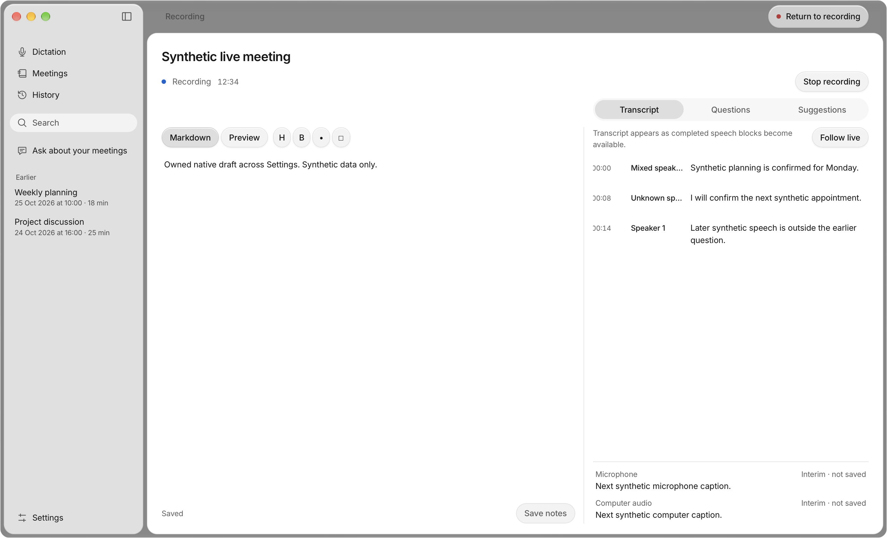
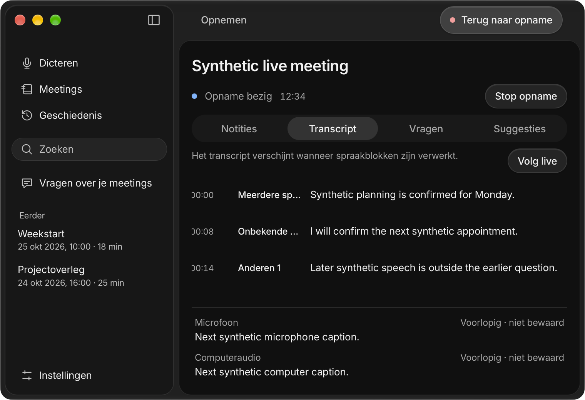

# Durable speaker turns — 3 November 2026

Implementation for [#22](https://github.com/pennel-app/pennel/issues/22), stacked on [#17 / PR #127](https://github.com/pennel-app/pennel/pull/127). The code candidate is `2a8b66c`; the personally signed desktop binary was built from `b93a1a4` with identical desktop behavior. The later change fixes the iPhone cache's use of the existing exported lightweight revision snapshot.

## Delivered contract

Canonical utterances retain immutable identity, physical source, actual timing, exact text, inferred attribution, revisions and correction provenance. The existing Segment API remains a compatibility projection. Local and Apple final recognition retain actual timing from the same inference; text APIs remain available. Untimed or unreliable alignment stays mixed/unknown rather than distributing words or duplicating a chunk.

Both physical sources can receive neutral voices without enrollment. Valid manual corrections win over remembered matches; ambiguous remapping retains the user's work for review. Sources, row IDs, citations and playback remain independent of mutable person labels. Semantic naming and broader correction controls remain with #59/#100.

Readable `transcript.md` plus verified `transcript.meta.json`/hash-named root parts form one recoverable snapshot. Parts stay below one MiB for existing sealed text sync. Checked reads refuse partial, corrupt and unsupported generations; writes use revision guards and recoverable multi-file commits. Proven generated-part retention is bounded while complete backup/conflict copies remain protected. Legacy Me/Others fields are a lossy projection, not proof of person or physical source; current UI, questions, summaries, exports and playback use canonical metadata.

## Verification

| Check | Result |
|---|---|
| Core release/tests | Built; 841 passed, 7 existing ignored; 17 keyboard tests passed |
| Desktop frontend | 264 tests and production build passed |
| Desktop backend | 253 tests passed |
| Core/backend formatting and strict Clippy | Passed |
| Mac platform Swift | 139 passed |
| Mobile types/UI/plugins/widgets/helpers | Passed; 116 UI, 17 plugin, 7 widget and 116 portable Swift tests |
| Matching iOS Rust libraries/bindings | Device and simulator generated |
| Clean/repeated Prebuild and deployment pods | Passed, including six pod ownership checks |
| Hosted iOS tests | 169 passed, no failures/skips |
| Unsigned ARM64 Release builds | Simulator and device passed sequentially |

Regression coverage includes rapid/short/overlapping turns; exact text conservation and malformed timing; both-track hybrid voice reservations; explicit enrolled-self estimates; manual names and high-revision reruns; old/unparsed files; partial/out-of-order encrypted sync; every journal boundary; and stale-source refusal. A 240-update hour fixture and 60/120-minute format fixtures prove bounded current parts and protected backups/conflicts. These are automated data/algorithm results, not measured real-speaker accuracy.

Independent review repaired enrolled-self persistence, exhausted voice allocation, cross-track overlap collisions, rerun revision loss, ambiguous legacy source inference and unbounded superseded parts. Source labels also remain honest in questions, summaries and EN/NL exports.

Commands use `scripts/with-toolchain.sh`; native builds use `/Users/landerparren/.local/bin/worktree-storage run --`. Full logs remain under ignored `build/issue22*` and `build/utterance-*`. Mobile dependencies were materialized from the same installed versions using APFS clones so autolinking resolves this checkout's own native module; the lockfile was unchanged. iOS configurations run sequentially because React Native's Pod framework selection is shared.

## Owned interface evidence

EN/NL light/dark browser fixtures cover stable rows/citations, unknown/mixed/overlap labels, manual names, readonly metadata, IME/selection/scroll, sources and physical playback routing. Sixteen real packaged macOS window captures additionally exercise isolated Markdown saves, Settings and native Close/Finder reopening. Live capture/provider IPC and composition events are synthetic; no audio device was opened.

The native executable SHA-256 is `8b10183b5baf94b8cd9b4312e5e5baa87f8f51c33e1ec507e97869e975494605`; strict signing verification pins personal team **B538Q2K76C**. Reproduce with `python3 -B scripts/verify-speaker-turns-native.py --window-helper <owned-window-helper> --locale both --appearance both --output build/issue22-native-qa`.

## Remaining acceptance

No acoustic accuracy, DER, speaker-attributed word error or real-call latency/CPU/aggregate RSS figure is claimed. Compare the baseline and candidate on the same consented English, Dutch/Flemish and mixed recordings with two/four/six voices, short acknowledgments, similar/unknown voices, overlap, room microphones and hybrid calls. Keep actual route/echo/device evidence under #5/#47, long-session evidence under #12 and signed iPhone acceptance under its existing owner. Installed Windows/Linux and review/merge remain open. No model download, paid inference, deployment or release occurred.
